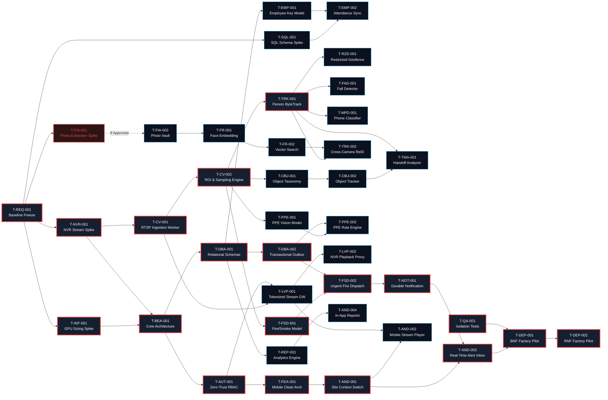

# 06 — Master Task Dependency Graph & Critical Path Analysis

**Document ID:** DISC-06-DEPENDENCY-GRAPH  
**Version:** 1.0.0-baseline  
**Status:** COMPLETE GRAPH  
**Classification:** STRICTLY NON-MOCK / EVIDENCE-BASED  
**Traceability Reference:** DISC-05-TASK-INVENTORY & PLAN-001  

---

## 1. High-Level Phase Progression & Decision Gates

```mermaid
flowchart TD
    classDef phase fill:#161F30,stroke:#0EA5E9,stroke-width:2px,color:#F8F9FA;
    classDef gate fill:#0B111E,stroke:#F59E0B,stroke-width:2px,color:#F59E0B;
    classDef blocker fill:#2D1515,stroke:#EF4444,stroke-width:2px,color:#EF4444;

    P0["PHASE 0: Discovery & Audit (Current)"]:::phase --> G0{"GATE 0: Owner Review & Approval"}:::gate
    
    G0 --> P1["PHASE 1: Technical & Hardware Spikes"]:::phase
    P1 --> G1{"GATE 1: Spike Verification Gate"}:::gate
    
    G1 --> P2["PHASE 2: Engineering Foundation & CI"]:::phase
    P2 --> G2{"GATE 2: Foundation & Test Gate"}:::gate
    
    G2 --> P3["PHASE 3: Site, Identity & Device Adapters"]:::phase
    P3 --> G3{"GATE 3: Integration Isolation Gate"}:::gate
    
    G3 --> P4["PHASE 4: Video Pipeline & Model Training"]:::phase
    P4 --> G4{"GATE 4: Model Accuracy Calibration Gate"}:::gate
    
    G4 --> P5["PHASE 5: Event Engine & Urgent Alert Outbox"]:::phase
    P5 --> G5{"GATE 5: Alert Routing Resilience Gate"}:::gate
    
    G5 --> P6["PHASE 6: Android Manager Client Application"]:::phase
    P6 --> G6{"GATE 6: Mobile Ergonomics & Auth Gate"}:::gate
    
    G6 --> P7["PHASE 7: Reporting, Hardening & 2-Site Pilot"]:::phase
    P7 --> G7{"GATE 7: Production Readiness Sign-Off"}:::gate
```

---

## 2. End-to-End Critical Path Dependency Graph

The critical path represents the minimum sequenced path through the project where any delay directly postpones production readiness.

---

## 3. Bottleneck Analysis & Risk Mitigations

| Bottleneck Node | Risk Description | Critical Path Impact | Engineering Mitigation Strategy |
|---|---|---|---|
| **T-INF-001 (GPU Sizing)** | Current server has zero GPUs; procurement lead time for enterprise GPUs can take 4–8 weeks. | Blocks real-time inference across all 6 vision models. | **Primary Mitigation:** Run Phase 1 spikes on cloud/leased GPU instances to validate models immediately while hardware procurement executes concurrently. |
| **T-FIA-001 (Photo Extraction)** | Biometric terminals may not export RGB JPEG images via ZKBioTime. | Blocks Category I (Face Recognition) and Category K (ReID Cross-Camera Matching). | **Isolated Path:** Decouple Face Recognition from the critical path! The system operates with full value using Person Detection, PPE, Fire, Intrusion, and Falls while photo extraction is resolved. |
| **T-NVR-001 (NVR Discovery)** | Heterogeneous NVR fleet with unknown RTSP/ONVIF support and concurrent session caps. | Blocks RTSP ingestion worker and mobile video streaming. | **Primary Mitigation:** Prioritize discovery of top 3 NVR models representing 80% of cameras; implement go2rtc stream multiplexer to bypass concurrent connection limits. |
| **T-FSD-002 (Urgent Fire Dispatch)** | Urgent fire routing must achieve sub-second delivery with zero false alarms and zero manual gates. | Directly governs life safety and emergency response. | **Primary Mitigation:** Implement temporal persistence filtering (>3.0s continuous flame/smoke) and dedicated Redis priority queue bypassing ordinary rate-limiters. |
| **T-QA-001 (Site Isolation Tests)** | Any leakage of RNF data to BNF managers is a critical security failure. | Prerequisite for multi-tenant pilot release. | **Primary Mitigation:** Automated negative integration test suite running in CI that asserts HTTP 403 on all unauthorized cross-tenant requests. |

---

## 4. Work Breakdown by Parallel Workstreams

To optimize engineering velocity following Gate 1 sign-off, four parallel engineering streams will execute concurrently:

1. **Stream 1: Platform & Security Core (Backend & DB)**
   - Tasks: T-BEA-001, T-BEA-002, T-DBA-001, T-DBA-002, T-AUT-001, T-SEC-001, T-SEC-002, T-NOT-001.
2. **Stream 2: Video & AI Pipeline (Edge Ingestion & Vision Models)**
   - Tasks: T-CV-001, T-CV-002, T-PPE-001, T-FSD-001, T-TRK-001, T-RZD-001, T-FAD-001, T-MPD-001, T-OBJ-001.
3. **Stream 3: Mobile Experience (Android Manager App)**
   - Tasks: T-DS-001, T-DS-002, T-FEA-001, T-FEA-002, T-AND-001, T-AND-002, T-AND-003, T-AND-004.
4. **Stream 4: Enterprise Hardware & Integrations (NVR, SQL, ZKBioTime)**
   - Tasks: T-INF-001, T-INF-002, T-NVR-001, T-LVP-001, T-SQL-001, T-ZKB-001, T-REP-001, T-REP-002.

