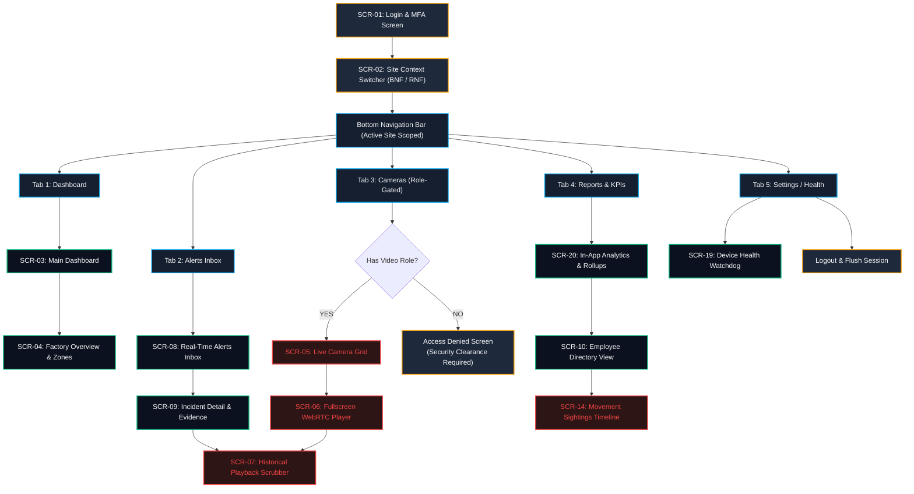
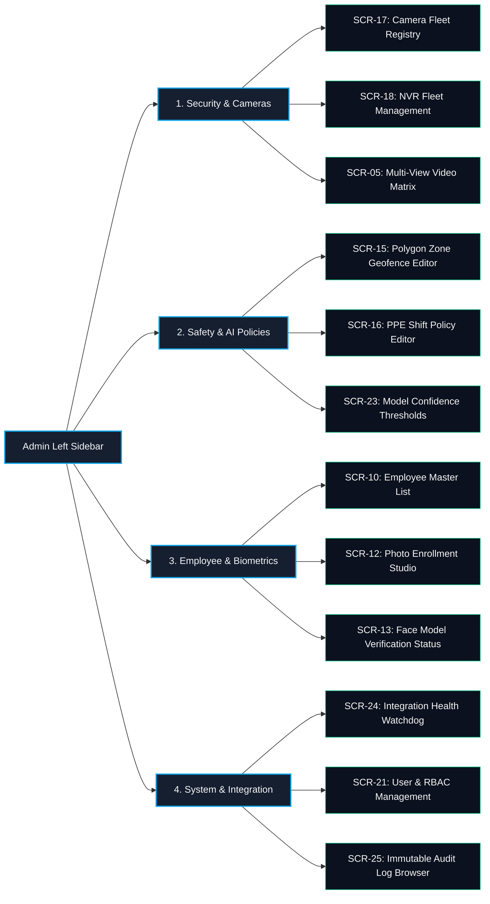

# 10 — Screen & Navigation Inventory across Platforms

**Document ID:** DISC-10-SCREEN-INVENTORY  
**Version:** 1.1.0-remediated  
**Status:** PROPOSED INFORMATION ARCHITECTURE (Awaiting Owner DEC-02 Approval for Web Admin)  
**Classification:** STRICTLY NON-MOCK / EVIDENCE-BASED  
**Traceability Reference:** SRS-001 Section 4, CTO Directive Section 6, Documents 26, 35 & 38  

---

## 1. Multi-Platform Screen Mapping Matrix

To maintain operational clarity and prevent mobile interface overcrowding, screens are explicitly assigned to their appropriate client form factor:
- **Android Mobile App (`OWNER_CONFIRMED_REQUIREMENT`):** Primary handheld interface for Factory Managers, Security Heads, and Corporate Executives. Optimized for rapid situational awareness, alert response, tokenized video viewing, and scheduled reports.
- **Web Administration Console (`PROPOSED` — Subject to Owner Decision DEC-02):** Dedicated administrative console for Safety Directors, Security Administrators, and IT Engineers. Optimized for complex spatial polygon mapping, camera channel inventory, policy rule authoring, and audit log analysis.

| Screen ID | Screen Name | Target Platform | Governance Status | Primary User Roles | Core Functionality & Access Rule |
|---|---|---|---|---|---|
| **SCR-01** | Secure Login & MFA | Android & Web | `OWNER_CONFIRMED_REQUIREMENT` | All Users | Authenticates credentials, verifies MFA token, mints scoped JWT. |
| **SCR-02** | Factory Selection Modal | Android & Web | `OWNER_CONFIRMED_REQUIREMENT` | All Multi-Site Users | Explicit modal switching context between BNF and RNF with clear visual isolation. |
| **SCR-03** | Main Operational Dashboard | Android & Web | `OWNER_CONFIRMED_REQUIREMENT` | All Authorized Managers | Active site KPIs, hourly event sparklines, active camera health count. Verified empty state when 0 events. |
| **SCR-04** | Factory Overview & Topology | Android & Web | `OWNER_CONFIRMED_REQUIREMENT` | All Authorized Managers | Map/schematic view of factory zones, camera placement, active shifts. |
| **SCR-05** | Camera Monitoring Grid | Android & Web | `OWNER_CONFIRMED_REQUIREMENT` | Security & Senior Mgmt Only | Multi-channel live video grid (2x2 / 3x3) with stream health indicators. Role-gated. |
| **SCR-06** | Live Fullscreen Camera View | Android & Web | `OWNER_CONFIRMED_REQUIREMENT` | Security & Senior Mgmt Only | Full-resolution WebRTC player, PTZ controls (if supported), audio/HUD overlay. |
| **SCR-07** | Recording Playback & Seek | Android & Web | `OWNER_CONFIRMED_REQUIREMENT` | Security & Senior Mgmt Only | 30-day timeline scrubber, motion markers, clip export request. |
| **SCR-08** | Alerts Center / Inbox | Android & Web | `OWNER_CONFIRMED_REQUIREMENT` | Factory, Company & Security Mgmt | Real-time reactive stream of events, severity filter, acknowledge triage. |
| **SCR-09** | Incident Details & Evidence | Android & Web | `OWNER_CONFIRMED_REQUIREMENT` | Factory, Company & Security Mgmt | Full event context: clip snapshot, 15s MP4, confidence score, model version. |
| **SCR-10** | Employee Directory | Android & Web | `OWNER_CONFIRMED_REQUIREMENT` | HR, Factory & Security Mgmt | Site-scoped roster synced from SQL Server/ZKBioTime; stable Employee IDs. |
| **SCR-11** | Employee Profile & Attendance | Android & Web | `OWNER_CONFIRMED_REQUIREMENT` | HR & Factory Managers | Shift history, attendance punch records, assigned department. Read-only. |
| **SCR-12** | Employee Image Import / Enroll | Web Admin | `PROPOSED` (DEC-02 / DEC-03) | Safety & HR Admins Only | Administrative photo upload and validation tool (Fallback for BLK-001). |
| **SCR-13** | Face Enrollment Status Matrix | Web Admin | `PROPOSED` (DEC-02) | Safety & Security Admins | Audit view showing which employees have verified face models vs missing photos. |
| **SCR-14** | Employee Movement History | Android & Web | `OWNER_CONFIRMED_REQUIREMENT` | Security & Senior Mgmt Only | Chronological timeline of discrete camera sightings with location and Cairo timestamps. |
| **SCR-15** | Restricted Zones Manager | Web Admin | `PROPOSED` (DEC-02) | Safety Directors & Admins | Interactive desktop canvas for drawing and adjusting restricted polygon geofences. |
| **SCR-16** | PPE Rule Matrix Editor | Web Admin | `PROPOSED` (DEC-02) | Safety Directors & Admins | Matrix assigning required PPE items to specific zones and work shifts. |
| **SCR-17** | Camera Fleet Management | Web Admin | `PROPOSED` (DEC-02) | IT & Security Engineers | Channel registry, IP assignments, RTSP sub-stream configuration, FPS caps. |
| **SCR-18** | NVR Fleet Management | Web Admin | `PROPOSED` (DEC-02) | IT & Security Engineers | NVR device inventory, firmware version, credentials, storage volume status. |
| **SCR-19** | Device & Stream Health Center| Android & Web | `OWNER_CONFIRMED_REQUIREMENT` | IT & Security Engineers | Real-time monitoring of RTSP drop rates, inference latency, worker health. |
| **SCR-20** | In-App Reports & Analytics | Android & Web | `OWNER_CONFIRMED_REQUIREMENT` | Factory & Company Mgmt | Scheduled daily, weekly, monthly reports; vector charts and percentages (Africa/Cairo time). |
| **SCR-21** | User Management & Identity | Web Admin | `PROPOSED` (DEC-02) | Platform Administrators | Creation of manager accounts, role assignment, password policies. |
| **SCR-22** | Permissions & Role Policies | Web Admin | `PROPOSED` (DEC-02) | Platform Administrators | Granular capability assignment (e.g., granting video access to specific roles). |
| **SCR-23** | System & Model Settings | Web Admin | `PROPOSED` (DEC-02) | System Administrators | AI confidence threshold tuning, model canary deployment, retention rules. |
| **SCR-24** | Integration Health Dashboard | Web Admin | `PROPOSED` (DEC-02) | IT & System Engineers | Connection status for SQL Server, ZKBioTime APIs, Valkey, and S3 Storage (SeaweedFS). |
| **SCR-25** | Tamper-Evident Audit Logs | Web Admin | `PROPOSED` (DEC-02) | Security & Compliance Officers | Immutable audit trail of every login, video stream session, and policy change. |

---

## 2. Android Manager Mobile Application Navigation Architecture



---

## 3. Web Administration Console Navigation Architecture



---

## 4. State Handling Protocol Across All Screens

Every screen across Android and Web must implement explicit, deterministic handlers for the five universal application states:

```text
+-------------------+---------------------------------------------------------------------------------+
| UI STATE          | MANDATORY RENDERING BEHAVIOR (ZERO MOCK DATA RULE)                              |
+-------------------+---------------------------------------------------------------------------------+
| 1. LOADING        | High-contrast skeleton shimmer matching exact card proportions. No spinners.    |
+-------------------+---------------------------------------------------------------------------------+
| 2. VERIFIED EMPTY | Explicit empty card: "Zero incidents recorded for BNF in this shift.           |
|                   | Database connection healthy. Last sync: 21:45:00 Cairo (19:45:00 UTC)."        |
|                   | Zero invented records. No placeholder data.                                    |
+-------------------+---------------------------------------------------------------------------------+
| 3. ACTIVE DATA    | High-density data rendering with explicit UTC & Cairo timestamps, IDs, conf.   |
+-------------------+---------------------------------------------------------------------------------+
| 4. STALE / OFFLINE| Persistent amber banner: "Network disconnected. Displaying cached data from     |
|                   | 21:30:00 Cairo (19:30:00 UTC). Live streaming and real-time alerts paused."     |
+-------------------+---------------------------------------------------------------------------------+
| 5. ERROR / DENIED | Explicit error card explaining root cause (e.g., HTTP 403 Forbidden, NVR       |
|                   | timeout) with Retry button and direct diagnostic error code.                    |
+-------------------+---------------------------------------------------------------------------------+
```

---

## 5. Screen Inventory Sign-Off

- **Status:** PROPOSED.
- **Next Step:** Owner review and approval to proceed with Phase 1 technical spikes.

