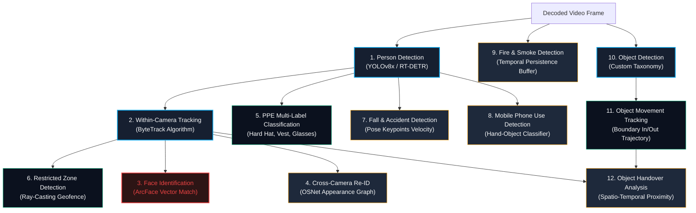

> ⚠️ SUPERSEDED / REFERENCE-ONLY (2026-11-16). Do NOT use as a source of truth. Authoritative: 00_READ_ME_FIRST.md and docs/governance/CTO_AMENDMENTS.md. Known stale content: counts of requirements, banned stack (YOLOv8/TensorRT/DeepStream/MinIO), capacity sizing, "VERIFIED_BY_EXECUTION" labels, Docker Desktop/Go 1.22 LTS claims.

# 12 — Video AI Evaluation, Benchmarking & Model Governance Plan (Remediated)

**Document ID:** DISC-12-VIDEO-AI-EVAL  
**Version:** 1.1.0-remediated  
**Date:** 2026-11-11  
**Status:** REVALIDATED AI EVALUATION FRAMEWORK  
**Classification:** STRICTLY NON-MOCK / EVIDENCE-BASED  
**Directive Reference:** Section 7 of CTO Directive  
**Skills Invoked:** `ml-best-practices`, `managing-python-dependencies`  

---

## 1. Core Engineering Principle: Observations vs. Certified Facts

In strict alignment with the CTO Master Directive:
> **An AI model outputs probabilistic visual observations with confidence scores. It never establishes unquestionable facts or replaces certified industrial safety systems.**

### Critical Clarifications Enforced in v1.1:
1. **ByteTrack vs. Cross-Camera Re-Identification:** ByteTrack is strictly an **intra-camera tracking algorithm** utilizing Kalman motion filtering and bounding box overlap. It does **NOT** extract deep appearance features and **CANNOT** re-identify individuals across disconnected camera views. Cross-camera Re-ID is an independent, distinct deep learning capability.
2. **Auxiliary Fire Detection Role:** Optical video fire/smoke detection is strictly an **auxiliary, early visual warning mechanism**. It is **NOT** certified under industrial fire standards (NFPA 72 or EN 54) and must **NEVER** be represented as a replacement for certified smoke/heat detectors, sprinkler systems, or manual pull stations installed in the factories.

---

## 2. Decoupled Evaluation Framework: The 12 Distinct AI Capabilities

Every AI capability is architected as an independent model pipeline with distinct failure modes, training datasets, and acceptance criteria:

---

## 3. Detailed Model Specifications Across All 12 Capabilities

| Capability ID | Technical Capability | Candidate Model Architecture | Evaluation Dataset & Negative Cases | Primary Metric Target | Operational False-Alarm Budget | Failure Modes & Limitations |
|---|---|---|---|---|---|---|
| **C-01** | **Person Detection** | YOLOv8x / RT-DETR-L (TensorRT FP16) | Factory pedestrian dataset (Day/Night, indoor/outdoor). Negatives: mannequins, clothing on racks. | Precision ≥ 95%, Recall ≥ 92% | <1 false person per camera/day | Distant workers (<30px height), extreme shadows. |
| **C-02** | **Within-Camera Tracking** | ByteTrack (Kalman Filter + IoU) | Intra-camera video tracks. Negatives: crossing workers, temporary pillar occlusions. | MOTA ≥ 75%, IDF1 ≥ 80% | Track ID persistence >30 occluded frames | Sudden 180° direction reversal during full occlusion. |
| **C-03** | **Face Identification** | ArcFace ResNet-50 (Cosine Metric) | Enrolled employee photo embeddings. Negatives: off-angle (>30°), low resolution, dust. | Cosine Sim ≥ 0.65; FAR < 0.01% | Force `UNKNOWN` if score < 0.65 | **BLOCKED** pending Phase 1 photo retrieval spike. |
| **C-04** | **Cross-Camera Re-ID** | OSNet / FastReID + Temporal Graph | Multi-camera corridor transition clips. Negatives: workers wearing identical factory uniforms. | Rank-1 Accuracy ≥ 70%, mAP ≥ 60% | Flag as `Provisional Match` with explicit gap | Uniform similarity; camera clock drift >5 seconds. |
| **C-05** | **PPE Classification** | Two-Stage Detector (Person Crop -> Head/Torso Multi-Label) | Zone-specific PPE validation sets. Negatives: baseball caps, jackets carried in hands. | Precision ≥ 92%, Recall ≥ 88% | Max 2 false alarms per camera/shift | Loose clothing, dark helmets against dark backgrounds. |
| **C-06** | **Restricted Zone Detection** | Spatial Ray-Casting Polygon Intersection | Calibrated camera zone polygons. Negatives: shadows crossing boundary, optical parallax. | Precision ≥ 96%, Recall ≥ 98% | Max 1 false alarm per zone/week | Camera vibration/wind shifting physical alignment. |
| **C-07** | **Fall & Accident Detection** | YOLOv8-Pose + Rapid Aspect Ratio Shift | UR Fall dataset + simulated factory falls. Negatives: picking up tools, sitting on floor. | Recall ≥ 95%, Precision ≥ 85% | Max 1 false alarm per site/week | Slow sliding falls without rapid velocity change. |
| **C-08** | **Mobile Phone Detection** | Hand-to-Ear / Two-Hand Texting Classifier | High-angle machinery zone video. Negatives: barcode scanners, walkie-talkies, beverage mugs. | Precision ≥ 80%, Recall ≥ 75% | Max 3 false alarms per line/shift | Low stream resolution (<1080p); hand occluded by torso. |
| **C-09** | **Fire & Smoke Detection** | YOLOv8-Fire + Temporal Persistence Buffer (>3.0s) | Industrial fire/smoke dataset. Negatives: welding arc flashes, steam exhaust, diesel exhaust. | Recall ≥ 99.5%, Precision ≥ 90% | Max 1 false alarm per site/month | Dense steam clouds resembling smoke plumes. |
| **C-10** | **Object Detection** | Custom YOLOv8 Detector (Site Taxonomy) | Factory material dataset (cartons, sacks, bins). Negatives: empty pallets, trash bags. | Precision ≥ 85%, Recall ≥ 85% | Max 2 false alarms per dock/shift | Stacked boxes occluding individual unit boundaries. |
| **C-11** | **Object Movement Tracking** | Bounding Box Spatial Direction Analyzer | Loading dock & storage perimeter boundaries. Negatives: normal warehouse restock routes. | Precision ≥ 85%, Recall ≥ 85% | Max 2 false alarms per dock/shift | Forklift temporarily occluding tracked object. |
| **C-12** | **Object Handover Analysis** | Spatio-Temporal Proximity Graph Network | Two person tracks + transferring object track. Negatives: passing hand tools, walking together. | Precision ≥ 70%, Recall ≥ 75% | Always tag as `Suspected Transfer (High Uncertainty)` | Crowded corridors with multiple overlapping tracks. |

---

## 4. Conventional Fire Alarm System Integration & Life-Safety Governance

In compliance with NFPA 72 and industrial safety regulations:
1. **Auxiliary Alerting Channel:** Video AI fire events are routed to safety personnel as an **accelerated early visual notification**. They provide immediate visual verification (snapshot + live stream link) to safety personnel, allowing faster physical assessment.
2. **Non-Replacement Guarantee:** The surveillance platform does **NOT** connect to or replace the certified building fire alarm control panel (FACP), building sprinkler valves, or physical fire horns.
3. **Dual Confirmation Standard:** If the factory possesses an addressable fire alarm system, the platform can accept an optional contact-closure input from the FACP to instantly correlate physical smoke alarms with camera visual feeds.

---

## 5. Model Evaluation & Governance Sign-Off

- **Status:** REVALIDATED AI EVALUATION PLAN.
- **Action Item:** Authorize Phase 1 GPU model benchmark to measure empirical inference latency on representative video clips.
