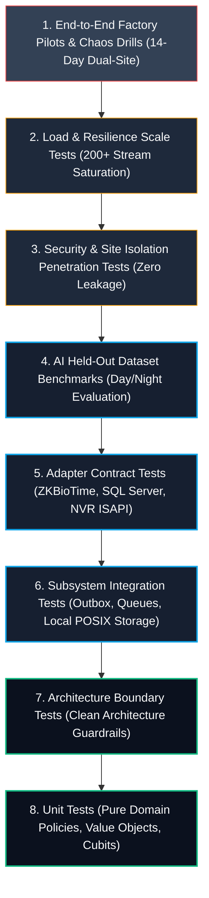

> ⚠️ SUPERSEDED / REFERENCE-ONLY (2026-11-16). Do NOT use as a source of truth. Authoritative: 00_READ_ME_FIRST.md and docs/governance/CTO_AMENDMENTS.md. Known stale content: counts of requirements, banned stack (YOLOv8/TensorRT/DeepStream/MinIO/Valkey/TimescaleDB/React), capacity sizing, "VERIFIED_BY_EXECUTION" labels, Docker Desktop/Go 1.22 LTS claims.

# 14 — Quality Assurance, Testing Pyramid & Acceptance Framework

**Document ID:** DISC-14-TEST-STRATEGY  
**Version:** 1.1.0-remediated  
**Status:** MANDATORY QUALITY FRAMEWORK  
**Classification:** STRICTLY NON-MOCK / EVIDENCE-BASED  
**Traceability Reference:** QA-001, SRS-001, PLAN-001, Documents 26–35  

---

## 1. The Quality Mandate: Zero Compromise

In strict adherence to the project's engineering principles:
> **A task is never complete because code compiles or an AI generator outputted text. A feature is DONE only when its behavior is validated by automated, reproducible tests supported by empirical evidence.**

The platform employs a multi-tiered **Testing Pyramid** designed to validate every layer of the system independently and in concert:

> **GOVERNANCE RULE ON PERFORMANCE EXPECTATIONS:**
> In accordance with CTO Directive, all numerical performance expectations (e.g., `<500ms`, `<1.0s`, `<250ms`) must strictly distinguish between three distinct engineering states:
> 1. **Candidate Benchmark Target:** Preliminary engineering design objective.
> 2. **Owner-Approved Acceptance Threshold:** Formally signed off by project owner.
> 3. **Measured Test Result:** Empirically recorded from executed benchmarks on real hardware and networks.
> No candidate benchmark target shall be presented as an approved acceptance threshold or measured result without explicit owner approval and documented test evidence.

---

## 2. Test Execution Levels & Tooling Matrix

| Test Level | Scope & Invariants Verified | Primary Tooling | Pass Criteria | Execution Stage |
|---|---|---|---|---|
| **Unit Tests** | Domain entities, policy rule specifications, time calculations, Dart Cubit state machines. | Go `testing` / Pytest / Dart `test` | 100% pass; statement coverage >85%. | Pre-commit / CI PR Gate |
| **Architecture Tests** | Enforces Clean Architecture boundaries (Domain imports zero infra/vendor code). | ArchUnit (Java/Go) / Custom dependency linter | Zero architecture boundary violations. | CI PR Gate |
| **Contract Tests** | Validates HTTP/ODBC/RTSP adapters against mocked and real external endpoints. | Pact / WireMock / Python test harnesses | Zero schema drift; correct typed error mapping. | CI Nightly / Spikes |
| **Integration Tests**| Transactional outbox persistence, candidate Valkey Streams, candidate PostgreSQL migrations, controlled local POSIX storage lifecycle (all candidate runtimes subject to ADR-011 approval). | Testcontainers (Docker-based DB/Queue) | Zero orphaned records; clean rollbacks. | CI PR Gate |
| **AI Evaluation** | Precision, recall, F1, false alarm rate per operational unit on held-out site video. | Python scikit-learn / OpenCV / custom scripts | Precision >90%, Recall >85% (per AI-001 candidate targets). | Model Release Gate |
| **Security Tests** | Negative authorization tests, JWT forgery, cross-tenant resource injection. | OWASP ZAP / Custom security scripts | 100% rejection of unauthorized requests (403). | Release Gate |
| **Scale / Load Tests**| 200+ concurrent RTSP stream feeds, queue backlog recovery, video latency under load. | Locust / Custom synthetic RTSP load injector | p95 API latency candidate target <250ms (pending empirical benchmark); zero worker OOM crashes. | Phase 7 Hardening |
| **Mobile Golden Tests**| Pixel-perfect visual regression, high-contrast readability, error/empty states. | Flutter Golden Toolkit (`flutter test`) | Zero unapproved visual pixel diffs. | CI PR Gate |

---

## 3. Core Acceptance Scenarios (Traceable to SRS-001 & Documents 26–35)

| Scenario ID | Test Name & Operational Context | Invariant Verified | Expected Acceptance Result |
|---|---|---|---|
| **AT-SITE-001** | Factory Switcher Context Isolation | User switches from BNF to RNF in Android app. | All subsequent API calls carry `site_id=RNF`; zero BNF alerts or video channels displayed. |
| **AT-SITE-002** | Direct Cross-Site API Injection | BNF-authenticated user invokes `/api/v1/rnf/events` directly via curl. | Server returns HTTP 403 Forbidden with security audit log entry. Zero data returned. |
| **AT-VID-001** | Unauthorized Video Stream Denial | Factory Manager (without video role) requests live stream token. | Backend rejects token request with HTTP 403; mobile player displays locked security screen. |
| **AT-VID-002** | Authorized Stream Playback | Security Manager requests live stream token for Camera CAM-BNF-012. | Backend issues 60s HMAC token; WebRTC player connects within candidate target <500ms (engineering target, not approved acceptance threshold; subject to network condition benchmarks); access audited. |
| **AT-ALT-001** | Immediate Fire Dispatch Fast-Path | Fire model detects flame in Zone 3 with confidence 0.94. | Alert dispatches immediately (server dispatch candidate engineering target <500ms, not approved acceptance threshold; handset presentation measured empirically per Document 39) to BNF safety roster without waiting for manual confirmation. |
| **AT-ALT-002** | Zero Cross-Site Alert Leakage | Critical safety incident occurs at BNF factory. | Alert pushed to BNF Manager, Security Mgmt, and Corporate Mgmt; zero delivery to RNF-only users. |
| **AT-AI-001** | Strict Identity Anti-Hallucination | Person detected in Restricted Zone; face match cosine similarity is 0.52 (<0.65 threshold). | Event recorded as `association_status = "unknown_person"`; system **never** forces an employee ID. |
| **AT-AI-002** | Multi-Rate Sampling Invariant | Dynamic sampling adapts between 2 FPS baseline (PPE) and 10–15 FPS burst (fall detection). | Fall event (400–700ms) reliably captured within burst buffer; worker GPU stays within compute budget. |
| **AT-REP-001** | Cairo Midnight Daily Rollup | Daily reporting period closes at 00:00 Africa/Cairo (21:00 or 22:00 UTC per Law 24/2023). | Scheduled worker aggregates real DB incidents against Cairo calendar; handles DST shift without duplicate rollups. |
| **AT-EMPTY-001**| Strict Non-Mock Empty State | New deployment with zero incidents in database requests dashboard metrics. | Card renders explicit empty state with Cairo/UTC sync timestamp. Exactly zero synthetic rows created. |
| **AT-APP-001** | Stream Network Interruption | Physical camera cable disconnected during live view. | App displays explicit amber warning: `"Camera feed disconnected. Retrying connection..."` Zero freeze. |
| **AT-RET-001** | 30-Day Video Retention Purge | User requests playback footage from 35 days ago. | Storage lifecycle enforces unavailable state; request returns HTTP 404 (Purged under policy). |

---

## 4. Rigorous Definition of Done (DoD)

A requirement, task, or user story is formally classified as **DONE** if and only if all eight of the following criteria are objectively proven:

1. **Approved Specification:** Clear requirement mapping to SRS-001, Document 26, and ADR log.
2. **Implementation Integrity:** Production-quality code adhering to Clean Architecture; zero mock data, stubs, or hardcoded metrics in the production path.
3. **Automated Test Coverage:**
   - Unit tests covering all business rules and edge cases.
   - Integration/Contract tests validating external adapters.
   - Negative tests verifying error handling and site isolation.
4. **Security & Privacy Sign-Off:**
   - Zero secrets committed (verified via pre-commit scanner).
   - Server-side authorization verified; zero privilege escalation.
5. **Observability Instrument:** Structured logging, Prometheus metrics, and health checks implemented.
6. **Documentation & Traceability:** Traceability matrix updated; operational runbook authored.
7. **Peer Code Review:** Approved by Senior Engineering Architect following `flutter-code-review` / backend review standards.
8. **Reproducible Evidence:** Execution log, test report, or benchmark measurement permanently recorded.

---

## 5. Testing & Quality Strategy Sign-Off

- **Status:** APPROVED AS BASELINE FRAMEWORK (v1.1.0-remediated).
- **Next Step:** Implement test harnesses during Phase 2 Engineering Foundation.
