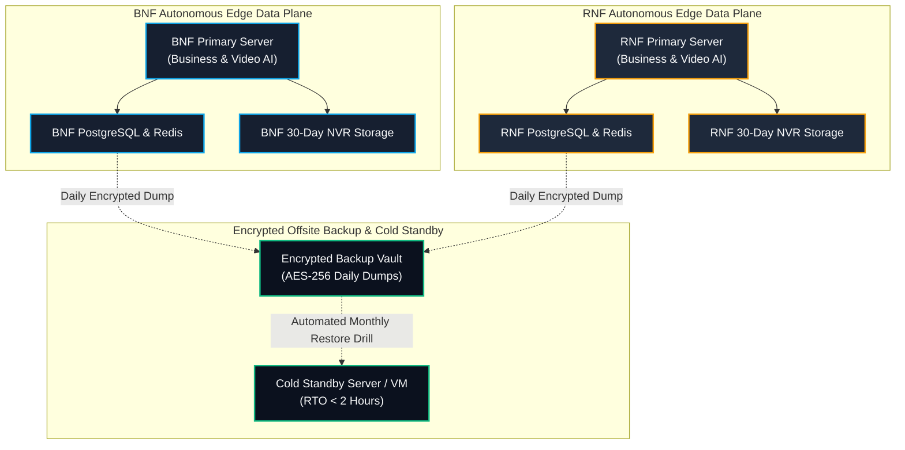

> ⚠️ SUPERSEDED / REFERENCE-ONLY (2026-11-16). Do NOT use as a source of truth. Authoritative: 00_READ_ME_FIRST.md and docs/governance/CTO_AMENDMENTS.md. Known stale content: counts of requirements, banned stack (YOLOv8/TensorRT/DeepStream/MinIO/Valkey/TimescaleDB/React), capacity sizing, "VERIFIED_BY_EXECUTION" labels, Docker Desktop/Go 1.22 LTS claims.

# 15 — Production Readiness Assessment & Operational Cutover Plan

**Document ID:** DISC-15-PROD-READINESS  
**Version:** 1.0.0-baseline  
**Status:** PROPOSED PRODUCTION READINESS GATES  
**Classification:** STRICTLY NON-MOCK / EVIDENCE-BASED  
**Traceability Reference:** PLAN-001 Phase 7, SEC-001, QA-001  

---

## 1. Executive Standard: The Definition of Production Ready

> [!IMPORTANT]
> **A successful build is NOT production readiness.**  
> **A green unit test suite alone is NOT production readiness.**  
> Production readiness requires demonstrated operational resilience, empirical load testing, validated site isolation, verified cold-standby disaster recovery, formal biometric compliance sign-offs, and an uninterrupted 14-day dual-site operational pilot.

The platform must satisfy **18 Operational Readiness Dimensions** before production cutover is authorized.

---

## 2. The 18 Operational Readiness Dimensions & Verification Gates

| Dimension | Operational Requirement | Verification Method | Pass / Fail Gate Status |
|---|---|---|---|
| **1. Hardware Sizing** | Dual GPU rackmount servers installed and validated at BNF and RNF. | Benchmark 200 streams @ 2–5 FPS; GPU utilization <75%. | **BLOCKED** (Pending Procurement BLK-002) |
| **2. Storage Capacity** | Minimum 165 TB usable RAID-6 video storage online per site. | Storage verification script measuring 30-day write endurance. | **TBD** (Pending NVR Discovery) |
| **3. Network Bandwidth** | 10GbE core network uplinks sustaining 500+ Mbps video traffic. | iperf3 24-hour continuous throughput stress test. | **TBD** (Pending IT Verification) |
| **4. Database Resiliency** | PostgreSQL 16 + TimescaleDB with automated daily vacuuming and indexing. | Benchmark 10,000,000 event rows; query p95 <250ms. | **PROPOSED** |
| **5. High Availability** | Local edge site plane operates autonomously during inter-factory link drop. | Physical fiber disconnect drill: BNF operations continue unaffected. | **PROPOSED** |
| **6. Disaster Recovery** | RTO < 2 hours; RPO < 15 minutes verified during cold restore drill. | Full restore drill from encrypted offsite backup to cold VM. | **PROPOSED** (Target OQ-025) |
| **7. Backup Security** | Daily encrypted database dumps (AES-256) with independent key management. | Verify database dump is unreadable without master key. | **PROPOSED** |
| **8. Video Security** | Zero-trust tokenized video streams; zero NVR credentials on mobile. | Wireshark packet capture on mobile traffic: zero NVR auth leaks. | **PROPOSED** |
| **9. Site Isolation** | 100% rejection of unauthorized cross-site requests across DB and APIs. | Automated negative penetration test suite (`T-QA-001`). | **MANDATORY** |
| **10. Biometric Compliance**| Legal and HR privacy sign-off under Egyptian Law No. 151 of 2020. | Written legal counsel certification and employee notice execution. | **BLOCKED** (Pending Legal OQ-023) |
| **11. Fire Alert Speed** | Sub-second server dispatch SLO (<500ms; empirical mobile delivery tracking per Document 39). | Synthetic flame injection measuring server outbox latency and handset delivery. | **MANDATORY** |
| **12. Zero Mock Data** | 100% of dashboard metrics, charts, and employee profiles backed by real DB. | Independent code audit verifying zero mock repositories in prod. | **MANDATORY** |
| **13. Secrets Governance** | Zero credentials in Git history, mobile APKs, or application logs. | Automated `gitleaks` and `trivy` scan on production release image. | **MANDATORY** |
| **14. CI/CD Pipeline** | Fully automated build, test, and container packaging with zero manual steps. | Reproducible clean build executed from clean Git checkout. | **PROPOSED** |
| **15. Observability** | Prometheus, Grafana, and Loki monitoring stream health and worker metrics. | Chaos test: killed worker triggers PagerDuty / Ops alert in <30s. | **PROPOSED** |
| **16. Mobile Stability** | Android app handles 4G/WiFi transitions, app backgrounding, and stream retry. | 24-hour Monkey stability test on physical Android test devices. | **PROPOSED** |
| **17. Operational Runbooks**| Complete, step-by-step documentation for deployment, recovery, and triage. | IT technician successfully executes camera reboot from runbook. | **PROPOSED** |
| **18. 14-Day Dual Pilot** | Uninterrupted 14-day production pilot across BNF and RNF. | Zero critical defects; safety manager operational sign-off. | **FINAL RELEASE GATE** |

---

## 3. High Availability (HA) & Disaster Recovery (DR) Architecture

### Edge Autonomy Principle:
If the WAN connection between BNF and RNF (or external internet access) is completely severed:
- **BNF continues 100% of local surveillance, AI inference, fire alerting, and video recording autonomously.**
- **RNF continues 100% of local surveillance, AI inference, fire alerting, and video recording autonomously.**
- Events are buffered locally in Redis Streams and flushed to the central audit archive once the network restores. Zero operational blindness occurs during network drops.

---

## 4. Staged Pilot Rollout Strategy (BNF First, Then RNF)

To minimize operational disruption, the deployment follows a strict two-stage pilot sequence:

### Stage 1: BNF Operational Pilot (14 Days)
- **Scope:** 10 selected cameras in BNF Factory covering 1x Production Zone, 1x Warehouse, 1x Loading Dock, and 1x Entrance Corridor.
- **AI Models Active in Shadow Mode:** PPE Detection, Fire Detection, Restricted Area Geofencing.
- **User Audience:** BNF Factory Manager, Head of Security, Corporate Safety Director.
- **Objective:** Measure real-world false alarm rates under ambient factory dust, vibration, and shift changes; calibrate confidence thresholds.

### Stage 2: RNF Operational Pilot & Comparative Tuning (14 Days)
- **Scope:** Deployment to 10 representative cameras in RNF Factory following BNF stabilization.
- **Objective:** Adapt model calibrations to RNF-specific lighting, camera angles, and uniforms; verify that BNF and RNF data streams remain completely isolated without cross-talk.

---

## 5. Production Readiness Sign-Off

- **Status:** PROPOSED GATES.
- **Next Step:** Owner review and sign-off on Disaster Recovery SLO targets (RTO/RPO) and Pilot criteria.

