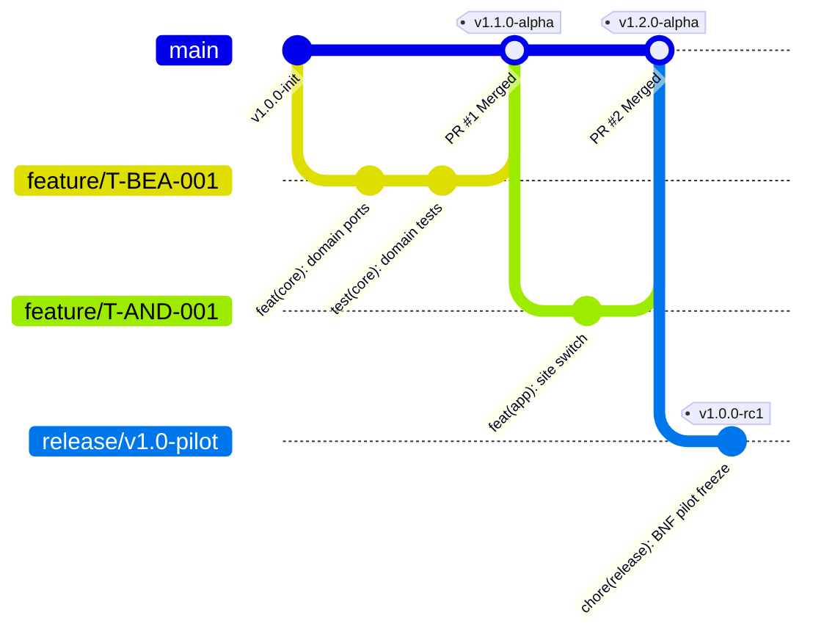
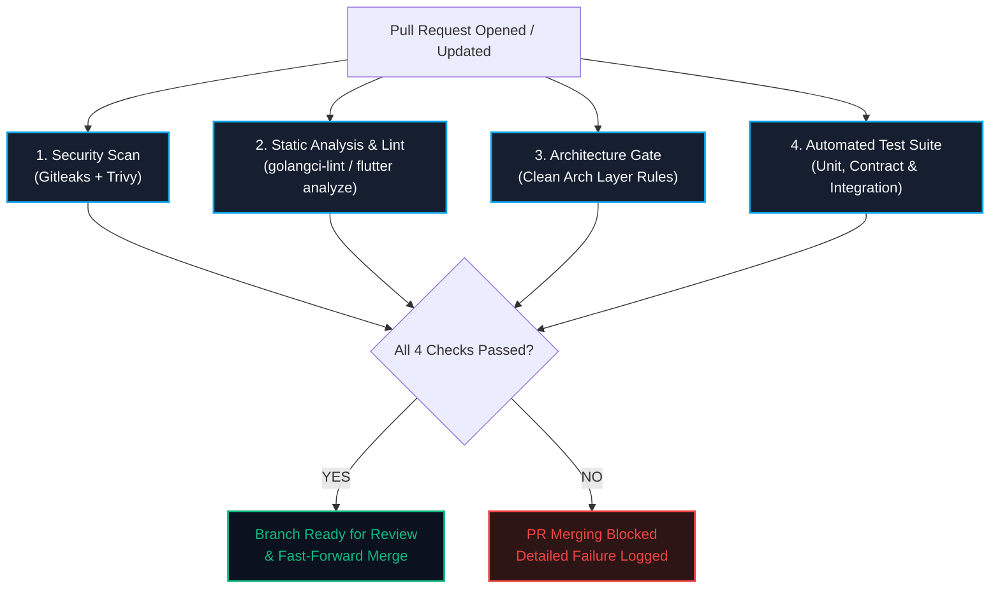

> ⚠️ SUPERSEDED / REFERENCE-ONLY (2026-11-16). Do NOT use as a source of truth. Authoritative: 00_READ_ME_FIRST.md and docs/governance/CTO_AMENDMENTS.md. Known stale content: counts of requirements, banned stack (YOLOv8/TensorRT/DeepStream/MinIO/Valkey/TimescaleDB/React), capacity sizing, "VERIFIED_BY_EXECUTION" labels, Docker Desktop/Go 1.22 LTS claims.

# 16 — Git Strategy, Branching Model & CI/CD Pipeline Proposal

**Document ID:** DISC-16-GIT-CICD  
**Version:** 1.0.0-baseline  
**Status:** PROPOSED GIT & CI/CD GOVERNANCE  
**Classification:** STRICTLY NON-MOCK / EVIDENCE-BASED  
**Traceability Reference:** Section 13 of CTO Directive, PLAN-001  

---

## 1. Absolute Source Control Restrictions (Phase 0 Compliance)

In strict accordance with Section 13 of the CTO Master Directive:
- **NO GitHub repository has been created or modified.**
- **NO code has been committed or pushed to any remote repository.**
- **NO project data, credentials, or employee records have been uploaded or exposed.**
- **NO alterations have been made to the workspace folder structure.**

Actual GitHub repository initialization and remote operations will occur **only when explicitly authorized by the project owner in a future phase**. This document presents the comprehensive Git and CI/CD strategy proposed for that future activation.

---

## 2. Proposed Git Repository Structure: Isolated Monorepo

To maintain atomic versioning between backend domain contracts, edge video workers, and the Android client application while preventing code sprawl, an **Isolated Monorepo** architecture is proposed:

```text
industrial-ai-surveillance/ (Private Git Repository)
├── .github/
│   ├── workflows/
│   │   ├── ci-backend.yml              # Go/Python static analysis, unit & contract tests
│   │   ├── ci-android.yml              # Flutter analyze, golden tests, release APK build
│   │   ├── security-scan.yml           # Gitleaks secret scan, Trivy CVE container audit
│   │   └── pr-gatekeeper.yml           # Clean Architecture boundary verification
│   ├── pull_request_template.md
│   └── CODEOWNERS                      # Mandatory CTO/Architect sign-off on Domain/Security
├── docs/                               # Canonical documentation & ADRs
├── src/
│   ├── backend/                        # Modular Monolith Business Core
│   ├── workers/                        # High-Performance Video Ingestion & AI Workers
│   └── client/android/                 # Flutter Android Manager Application
├── deploy/                             # Docker Compose & on-premise deployment manifests
└── tests/                              # Shared contract & integration fixtures
```

---

## 3. Branching Strategy: Scaled Trunk-Based Development

The team will operate under **Trunk-Based Development** to maintain continuous integration velocity, eliminate painful long-lived merge conflicts, and enforce automated quality gates:



### Branching Rules:
1. `main` (Trunk): Protected branch. Direct pushes are cryptographically disabled. Requires 100% passing CI checks and mandatory architectural peer approval.
2. `feature/<task-id>-<short-description>`: Short-lived feature branches branched from `main`. Lifetime capped at 48 hours to prevent merge drift.
3. `release/v<X.Y.Z>`: Release preparation branches used exclusively for staged pilot freezes and deployment smoke testing.
4. `hotfix/<incident-id>`: Emergency branches cut from release tags to fix critical production safety defects.

---

## 4. Conventional Commit Standards

Every commit message must adhere to the **Conventional Commits 1.0.0** specification linked directly to a Master Task ID:

```text
<type>(<scope>): <Task-ID> - <concise description in imperative mood>

[optional detailed body explaining rationale and engineering trade-offs]

[optional footer referencing requirement IDs or breaking changes]
```

### Allowed Types:
- `feat`: A new capability or domain usecase (e.g., `feat(alert): T-FSD-002 - implement sub-second fire dispatch route`).
- `fix`: A bug fix (e.g., `fix(video): T-LVP-001 - resolve token expiration race condition in WebRTC player`).
- `test`: Adding missing tests or correcting existing tests (e.g., `test(isolation): T-QA-001 - add negative cross-tenant API tests`).
- `refactor`: Code change that neither fixes a bug nor adds a feature (e.g., `refactor(db): T-DBA-001 - extract outbox publisher interface`).
- `docs`: Documentation only changes (e.g., `docs(adr): update ADR-002 with Go performance benchmark`).
- `chore`: Build scripts, CI workflow configs, dependency updates.

---

## 5. Automated CI/CD Pipeline & Quality Gate Architecture

Every Pull Request automatically triggers four parallel automated CI pipeline checks:



### Detailed Pipeline Check Specifications:
1. **Security & Secret Scanner:**
   - Runs `gitleaks detect --redact --verbose` against the PR commit diff.
   - Runs `trivy fs --severity HIGH,CRITICAL` checking for vulnerable dependencies.
   - Any detected credential or high-severity CVE immediately fails the build.
2. **Static Analysis & Linting:**
   - Backend: `golangci-lint run --enable-all` enforcing cyclomatic complexity <12, zero unhandled errors, and strict formatting.
   - Android: `flutter analyze --fatal-infos --fatal-warnings` enforcing strict null-safety and lint rules.
3. **Clean Architecture Boundary Gatekeeper:**
   - Custom script analyzing Go/Dart package imports:
   - Asserts: `src/backend/Domain` contains **0** imports from `src/backend/Infrastructure` or `github.com/gin-gonic` / external web frameworks.
   - Asserts: `src/client/android/lib/domain` contains **0** imports from `package:flutter` UI widgets.
4. **Automated Test Execution:**
   - Runs unit tests and contract tests in isolated Docker containers via Testcontainers.
   - Emits code coverage reports; PR fails if domain coverage drops below 85%.

---

## 6. Code Review Discipline & Merge Governance

- **Two-Person Rule:** Every PR requires at least one approving review from a Senior Systems Architect and one from the Mobile Lead.
- **Strict Code Review Checklist:** Reviewers follow the workspace skill `flutter-code-review` and CTO operating guidelines:
  - Is site isolation strictly enforced in every query?
  - Are error outcomes typed, or are exceptions silently swallowed?
  - Are there any mock data repositories disguised as production code?
  - Does this PR introduce unnecessary architectural complexity?
- **Merge Strategy:** **Squash and Merge** (or Fast-Forward Rebase) to maintain a linear, clean Git commit history on `main`.

---

## 7. Release Tagging & Semantic Versioning

Releases follow strict **Semantic Versioning 2.0.0** (`MAJOR.MINOR.PATCH`):
- `MAJOR`: Incompatible API changes, major site architecture migrations.
- `MINOR`: Backward-compatible feature additions (e.g., adding a new AI event class like Phone Detection).
- `PATCH`: Backward-compatible bug fixes, security patches, or threshold recalibrations.
- **Git Tags:** Signed Git tags (e.g., `v1.0.0-pilot.bnf`, `v1.1.0-prod`) created exclusively upon passing Gate 7 production readiness.

---

## 8. Git Strategy Sign-Off

- **Status:** PROPOSED GOVERNANCE.
- **Next Step:** Obtain Owner Approval prior to initializing private GitHub repository in Phase 2.

