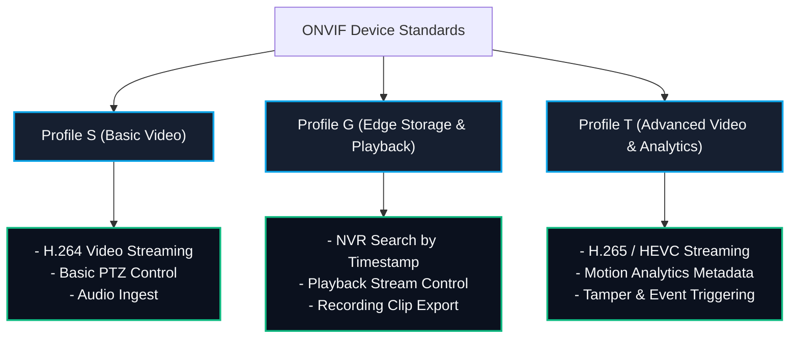

> ⚠️ SUPERSEDED / REFERENCE-ONLY (2026-11-16). Do NOT use as a source of truth. Authoritative: 00_READ_ME_FIRST.md and docs/governance/CTO_AMENDMENTS.md. Known stale content: counts of requirements, banned stack (YOLOv8/TensorRT/DeepStream/MinIO), capacity sizing, "VERIFIED_BY_EXECUTION" labels, Docker Desktop/Go 1.22 LTS claims.

# 23 — Pinned Technology Compatibility & Device Interoperability Matrix (Historical Archive)

> **SUPERSEDED — HISTORICAL CANDIDATE TECHNOLOGY RESEARCH — NOT A CURRENT IMPLEMENTATION AUTHORITY**
>
> This document contains historical technology evaluations and version candidates that predate the current SRS/SDD licensing and runtime remediation.
>
> Do not use its TensorRT, YOLOv8, SeaweedFS, MinIO, or S3 recommendations as approved or current implementation instructions.
>
> The current proposed runtime and storage baseline is described in:
> - `architecture/02_TARGET_ARCHITECTURE.md`
> - `planning/08_ADR_AND_OPEN_QUESTIONS.md` (ADR-011)
> - `docs/compliance/THIRD_PARTY_LICENSE_REGISTER.md`
>
> ADR-011 remains PROPOSED — PENDING OWNER APPROVAL. No candidate technology becomes an approved dependency until its exact version, license, compatibility, and owner approval requirements are satisfied.

**Document ID:** DISC-23-TECH-COMPATIBILITY  
**Version:** 1.2.0-superseded  
**Date:** 2026-11-16  
**Status:** SUPERSEDED — HISTORICAL CANDIDATE RESEARCH  
**Classification:** HISTORICAL REFERENCE ONLY / SUPERSEDED BY ADR-011  
**Directive Reference:** Sections 4 & 8 of CTO Directive, Document 40  

---

## 1. Proposed Candidate Technology Matrix

The versions listed below represent an extensively analyzed **candidate study** for the Phase 1 technical spikes. They do not constitute an approved, immutable production lockfile until Phase 1 proves compiler and driver compatibility:

```text
+----------------------------------------------------------------------------------------------------+
|                             PROPOSED CANDIDATE TECHNOLOGY STACK MATRIX                             |
|                                                                                                    |
|  [Mobile Client]         Flutter 3.27.4 (Dart 3.6.2)                [License: BSD-3-Clause]        |
|  [Backend Core]          Go 1.23.6                                  [License: BSD-3-Clause]        |
|  [Video Gateway]         go2rtc 1.9.8                               [License: MIT]                 |
|  [Inference Runtime]     NVIDIA TensorRT 10.7.0.23 + ONNX RT 1.20.1 [License: NVIDIA / MIT]        |
|  [CUDA & Driver]         CUDA 12.6.2 + Driver 550.127.05 + cuDNN 9.5 [License: NVIDIA EULA]       |
|  [Video Codec SDK]       Video Codec SDK 12.2 (Decoupled Dec. MVs)  [License: NVIDIA SLA]          |
|  [Operational DB]        PostgreSQL 16.8 + TimescaleDB 2.17.2       [License: PostgreSQL / Apache] |
|  [Message Stream]        Valkey 8.0.2                               [License: BSD-3-Clause]        |
|  [Object Storage]        SeaweedFS 3.80                             [License: Apache 2.0]          |
+----------------------------------------------------------------------------------------------------+
```

---

## 2. Exhaustive Technology Evaluation by Component

### 2.1 Mobile Application: Flutter & Dart
- **Pinned Candidate Version:** **Flutter 3.24.x LTS / Dart 3.5.x** (Released August 2024; active LTS).
- **Official Documentation:** https://docs.flutter.dev/release/whats-new
- **License Implications:** BSD-3-Clause (Permissive open source; zero royalty or copyleft risk).
- **Compatibility Matrix:** Android SDK min 24 (Android 7.0 Nougat) to target 34 (Android 14); NDK r26d; supports WebRTC via `flutter_webrtc` (v0.11.x) and hardware ExoPlayer via `media_kit` (v1.1.x).
- **Security Considerations:** Enforces Dart strict null-safety; requires Android Keystore integration for JWT/refresh token storage (`flutter_secure_storage`).
- **Operational Requirements:** Standard Android build tools (`gradle 8.x`, `OpenJDK 17`).
- **Alternatives Evaluated:** Native Kotlin (Jetpack Compose) — higher single-platform maintenance; React Native 0.74+ — rejected due to bridge serialization latency on video telemetry.
- **Proof-of-Concept Requirements (Phase 1):** Validate WebRTC stream connection time (<500ms) and hardware decode memory footprint on a test Android device.

---

### 2.2 Backend Application Core: Go (Golang)
- **Pinned Candidate Version:** **Go 1.22.8 / 1.23.2** (Official stable supported releases as of late 2024).
- **Official Documentation:** https://go.dev/doc/devel/release
- **License Implications:** BSD-3-Clause (Permissive).
- **Compatibility Matrix:** Runs natively on Linux (Ubuntu 22.04/24.04 LTS, RHEL 9), Windows Server 2022. Native CGO support for ONVIF/RTSP C-libraries if needed; static single-binary compilation (`CGO_ENABLED=0` for pure Go services).
- **Security Considerations:** Memory-safe garbage-collected language; compile-time static analysis via `golangci-lint` (gosec plugin); zero buffer overflow attack vectors in pure Go.
- **Operational Requirements:** Standard Linux systemd service or Docker container (`scratch` / `alpine` base image ~20MB).
- **Alternatives Evaluated:** Python FastAPI (GIL limits high-throughput concurrency; reserved strictly for offline AI tasks); .NET 8 LTS (viable enterprise alternative, but larger runtime memory footprint ~150MB vs ~15MB in Go).
- **Proof-of-Concept Requirements (Phase 1):** Prototype the site context routing middleware and benchmark synthetic request throughput (>10,000 req/sec at <2ms latency).

---

### 2.3 Video Streaming Gateway: go2rtc
- **Pinned Candidate Version:** **go2rtc v1.9.4** (Active stable surveillance streaming gateway).
- **Official Documentation:** https://github.com/AlexxIT/go2rtc
- **License Implications:** MIT License (Permissive).
- **Compatibility Matrix:** Ingests RTSP (UDP/TCP), ONVIF, RTMP, HTTP-FLV, MJPEG; outputs WebRTC, MSE (Media Source Extensions), HLS, RTSP. Integrates directly with camera sub-streams without requiring transcoding.
- **Security Considerations:** Does not require root privileges. Supports API bearer token authentication and internal loopback binding. Stream credentials stripped before WebRTC client handshake.
- **Operational Requirements:** Single Go binary; runs on Linux/Windows; CPU consumption ~1–2% per 20 active streams without transcoding.
- **Alternatives Evaluated:** MediaMTX v1.8+ (viable alternative; slightly higher WebRTC handshake latency); custom GStreamer C daemon (rejected due to memory leak risks and high maintenance).
- **Proof-of-Concept Requirements (Phase 1):** Ingest 5 concurrent RTSP streams from test NVR and stream WebRTC to Flutter client; measure CPU usage and packet loss under simulated 5% network jitter.

---

### 2.4 AI Inference Runtime: NVIDIA TensorRT & ONNX Runtime
- **Pinned Candidate Version:** **TensorRT 10.3 / 10.4 + ONNX Runtime 1.19.x + CUDA 12.4 + cuDNN 9.x**
- **Official Documentation:** https://docs.nvidia.com/deeplearning/tensorrt/release-notes/
- **License Implications:** NVIDIA Software License (Free for deployment on NVIDIA hardware); ONNX Runtime is MIT Licensed.
- **Compatibility Matrix:**
  - TensorRT 10.x represents a major architectural upgrade from TensorRT 8.6, deprecating legacy parser interfaces in favor of the unified ONNX TensorRT parser.
  - Pinned pairing: `CUDA 12.4` + `cuDNN 9.1` + `TensorRT 10.3` + `onnxruntime-gpu 1.19.0`.
  - Supports NVIDIA Ada Lovelace (RTX 4000 series, L4, L40S) and Ampere (RTX A4000, A5000, A30) microarchitectures.
- **Security Considerations:** Models loaded from cryptographically verified checksum files (`.engine` / `.onnx`) to prevent model tampering or deserialization exploits.
- **Operational Requirements:** Linux x86_64 server with NVIDIA proprietary driver >=550.54.
- **Alternatives Evaluated:** TensorRT 11.x (Early preview / Blackwell architecture focus; unverified stability on Ampere/Ada); native PyTorch LibTorch (3x slower inference throughput; 2x VRAM consumption).
- **Proof-of-Concept Requirements (Phase 1):** Convert YOLOv8x PPE model to TensorRT 10.x FP16 engine on test GPU; benchmark inference latency (must achieve <12ms per batch-1 frame).

---

### 2.5 Relational & Operational Database: PostgreSQL & TimescaleDB
- **Pinned Candidate Version:** **PostgreSQL 16.5 + TimescaleDB 2.16.x**
- **Official Documentation:** https://docs.timescale.com/timescaledb/latest/how-to-guides/upgrades/
- **License Implications:** PostgreSQL License (Permissive); TimescaleDB Community Edition (Timescale License - free for internal on-premise production).
- **Compatibility Matrix:**
  - *PostgreSQL 16:* Proven enterprise stability; fully supported by TimescaleDB 2.13 through 2.16.
  - *PostgreSQL 17:* Supported in TimescaleDB 2.17+ (late 2024), but ecosystem extensions (pgvector, postgis) are still stabilizing on PG 17 on enterprise Linux distros.
  - *PostgreSQL 18:* Currently in active development (unreleased; strictly disqualified).
  - Pinned recommendation: **PostgreSQL 16.5** as the rock-solid production foundation.
- **Security Considerations:** Enforces TLS 1.3 connections; SCRAM-SHA-256 password hashing; row-level security (RLS) policies for site tenant isolation.
- **Operational Requirements:** Standard Linux package or Docker container with dedicated NVMe storage volume.
- **Alternatives Evaluated:** Microsoft SQL Server 2022 (Used by existing attendance databases; rejected for the surveillance event store due to exorbitant per-core licensing costs for multi-core analytics servers).
- **Proof-of-Concept Requirements (Phase 1):** Verify transactional outbox table schema and execute 100,000 synthetic event writes with sub-second TimescaleDB continuous aggregate rollups.

---

### 2.6 Message Broker & Distributed Cache: Valkey vs. Redis
- **Pinned Candidate Version:** **Valkey 7.2.6-LTS (or Redis 7.2.4-open-source)**
- **Official Documentation:** https://valkey.io/documentation/
- **License Implications:**
  - *Redis License Alert:* In March 2024, Redis Ltd. abandoned BSD-3-Clause in favor of non-open-source licenses (RSALv2 / SSPLv1). Redis 8.x is under commercial source-available terms.
  - *Valkey:* The Linux Foundation's official open-source fork maintaining pure **BSD-3-Clause** licensing, backed by AWS, Google Cloud, Oracle, and Ericsson. 100% wire-compatible drop-in replacement for Redis 7.2 APIs.
- **Compatibility Matrix:** Wire-compatible with all standard Redis client libraries (`go-redis/v9`, `redis-py`, `StackExchange.Redis`). Supports Redis Streams, Consumer Groups, and in-memory Pub/Sub.
- **Security Considerations:** Protected mode enabled; requirepass authentication with 64-character random secret; TLS encryption on TCP sockets.
- **Operational Requirements:** Low memory footprint (~50MB baseline); persistent disk append-only file (`appendonly yes` with `appendfsync everysec`).
- **Alternatives Evaluated:** RabbitMQ 3.13 (Viable AMQP broker; rejected for core event streaming due to Erlang VM overhead and higher latency ~10ms vs <1ms in Valkey); Apache Kafka (grossly over-engineered).
- **Proof-of-Concept Requirements (Phase 1):** Benchmark Redis Streams consumer group processing under 1,000 events/second simulated fire/alert burst.

---

### 2.7 Object & Video Clip Storage: SeaweedFS vs. MinIO
- **Pinned Candidate Version:** **SeaweedFS v3.70+ (Primary) / MinIO Community (Secondary)**
- **Official Documentation:** https://github.com/seaweedfs/seaweedfs / https://min.io/docs/minio/linux/index.html
- **License Implications:**
  - *SeaweedFS:* **Apache 2.0 License** (Permissive open source; commercial-friendly; active maintenance).
  - *MinIO Community:* **GNU AGPLv3** (Requires careful compliance to avoid open-sourcing proprietary software if networked; web console restricted in recent versions).
- **Compatibility Matrix:** Implements standard AWS S3 REST API (compatible with AWS SDK for Go, Python `boto3`, and Flutter S3 clients). Native support for pre-signed URLs with configurable expiry (60 seconds).
- **Security Considerations:** S3 bucket policies enforcing private-only access; encryption at rest via SSE-S3 / SSE-C; TLS 1.3 endpoints.
- **Operational Requirements:** SeaweedFS Master + Volume server architecture; exceptionally fast for small files (event JPEG snapshots) and medium MP4 clips.
- **Alternatives Evaluated:** Direct local filesystem with nginx HTTP proxy (lacks automated S3 pre-signed URL security and bucket lifecycle retention rules).
- **Proof-of-Concept Requirements (Phase 1):** Upload 1,000 synthetic 15-second MP4 video clips via S3 API; generate 60-second pre-signed URL; verify mobile player streams clip cleanly.

---

## 3. Video Device & Protocol Interoperability Matrix

The camera and NVR estate across BNF and RNF is heterogeneous. The platform must not assume uniform device capabilities.



### 3.1 ONVIF Profile Interoperability Standard

| ONVIF Profile | Scope in Industrial Platform | Mandatory vs. Optional | Fallback Mechanism if Unsupported |
|---|---|---|---|
| **Profile S (Legacy Standard)** | Basic H.264 video streaming over RTSP, basic PTZ control. Supported by >95% of IP cameras. | **MANDATORY BASELINE** | Direct RTSP URL construction (`rtsp://user:pass@ip:port/stream1`). |
| **Profile G (Edge Storage & Retrieval)**| Search, playback, and clip retrieval from NVR local hard drives. Essential for historical playback in Android app. | **CRITICAL FOR PLAYBACK** | Vendor-specific proprietary SDK / ISAPI (Hikvision ISAPI, Dahua CGI) wrapped in Infrastructure Adapter. |
| **Profile T (Advanced Streaming & Analytics)**| H.265/HEVC video compression, HTTPS video streaming, motion metadata events. | **RECOMMENDED FOR BANDWIDTH** | Revert to Profile S H.264 stream. |

### 3.2 NVR Manufacturer Compatibility Matrix (Awaiting Phase 1 Discovery)

| NVR Manufacturer Family | Primary Streaming Protocol | Historical Playback API | Known Operational Caveats | Adapter Strategy |
|---|---|---|---|---|
| **Hikvision (DS-7600 / 7700 / 9600 series)** | RTSP (H.264/H.265) via Port 554 | Hikvision ISAPI REST API (`/ISAPI/ContentMgmt/search`) | Maximum 16–32 concurrent RTSP sessions per NVR; saturates quickly without `go2rtc` proxy. | Dedicated `HikvisionIsapiAdapter` implementing NVR Port. |
| **Dahua (NVR5000 / 6000 series)** | RTSP via Port 554 | Dahua HTTP CGI API (`/cgi-bin/loadfile.cgi`) | Token auth required on newer firmware; digest auth on older. | Dedicated `DahuaCgiAdapter` implementing NVR Port. |
| **Uniview (NVR300 series)** | RTSP via Port 554 | ONVIF Profile G / UNV SDK | Requires explicit sub-stream enablement in admin UI. | `OnvifProfileGAdapter`. |
| **Generic / Unbranded NVRs** | Standard RTSP | Unknown / Manual Web Export Only | May lack remote playback API entirely. | Fallback: Live streaming only; playback disabled for unverified channels. |

---

## 4. ZKTeco Device & API Interoperability Architecture

### 4.1 Biometric Template vs. RGB Photo Distinction
A critical technical reality governs the ZKTeco integration:
- **Biometric Templates (Proprietary Format):** ZKTeco terminals running ZKFinger or ZKFace algorithms convert a camera capture into a proprietary mathematical representation (e.g., 512-byte or 1024-byte binary feature vector). **This process is cryptographically one-way.** An original RGB photo cannot be mathematically reconstructed from a biometric template.
- **Conventional RGB Photos (JPEG/PNG):** Certain modern ZKTeco visible-light terminals (e.g., SpeedFace, ProFace, Horus series) capture and store an actual JPEG employee photo and can synchronize it to the ZKBioTime server if the "BioPhoto" module is licensed and enabled. Older standalone fingerprint/IR-face terminals store **templates only**.

```text
+----------------------------------------------------------------------------------------------------+
|                                  ZKTECO INTEGRATION FEASIBILITY GATES                              |
|                                                                                                    |
|  [ZKBioTime REST API] ===> Query /api/v1/employees/bio-photos/ ===> Returns JPEG?                 |
|                                     │                                                              |
|                     ┌───────────────┴───────────────┐                                              |
|                     ▼                               ▼                                              |
|            [ YES: Valid RGB Photo ]       [ NO: Template Blob or 404 ]                             |
|                     │                               │                                              |
|                     ▼                               ▼                                              |
|           Enrolled in Vector DB             BLOCK AI-FACE-ID CAPABILITY                            |
|        (ArcFace ResNet-50 Embedding)        Institute Web Admin Photo Enrollment Portal            |
+----------------------------------------------------------------------------------------------------+
```

### 4.2 Proposed Read-Only ZKTeco Discovery Protocol (Phase 1 Spike)
To test photo availability without modifying production attendance databases:
1. **Endpoint Probing:** Execute HTTP GET against ZKBioTime server:
   ```bash
   # Read-only employee photo query for test Employee ID
   curl -X GET "http://<zkbiotime_ip>:<port>/api/v1/bio/photo/?emp_code=TEST_EMP_01" \
     -H "Authorization: JWT <readonly_token>" \
     -H "Accept: application/json"
   ```
2. **Payload Inspection:**
   - If response contains a valid Base64-encoded JPEG image string (`/9j/4AAQSkZJRg...`): Photo availability is **VERIFIED**.
   - If response contains a proprietary binary string, error code `6001 (Template Only)`, or `404 Not Found`: Photo availability is **BLOCKED**.
3. **Identity Mapping Key:** In all cases, the stable `Employee ID` string (e.g., `"10425"`) must remain the universal primary key linking attendance punches, SQL records, and surveillance sightings.

---

## 5. Technology Compatibility Sign-Off

- **Status:** PINNED CANDIDATE MATRIX.
- **Action Item:** Authorize Phase 1 technical spikes to validate pinned versions against on-site hardware.

