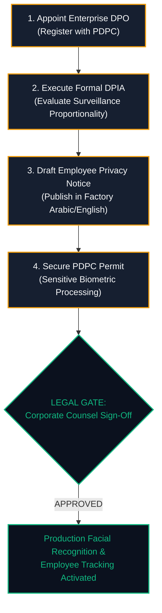

# 25 — Legal Compliance & Biometric Governance Action Register

**Document ID:** DISC-25-LEGAL-REGISTER  
**Version:** 1.0.0-remediated  
**Date:** 2026-11-11  
**Status:** MANDATORY LEGAL & REGULATORY COMPLIANCE FRAMEWORK  
**Classification:** STRICTLY NON-MOCK / EVIDENCE-BASED  
**Statutory Authorities:** Egyptian Personal Data Protection Law No. 151 of 2020 & Executive Regulations Decree No. 816 of 2025  

---

## 1. Statutory Context & Legal Disclaimer

This document establishes the mandatory data protection and regulatory compliance framework for the BNF and RNF Industrial AI Surveillance Platform under Egyptian jurisdiction.

> [!IMPORTANT]
> **LEGAL NOTICE & STATUTORY DISCLAIMER:**
> This document constitutes an **engineering compliance roadmap and technical risk assessment**. It does **NOT** substitute for formal legal counsel or a binding legal opinion. All biometric processing, employee surveillance notices, and data controller registrations must be formally reviewed and certified by the company's licensed legal counsel before production activation.

---

## 2. Egyptian Personal Data Protection Law No. 151 of 2020: Statutory Breakdown

### 2.1 Biometric Data Classification
- **Statutory Definition (Article 1):** Biometric data (البيانات الحيوية / البيومترية) is explicitly categorized as **"Sensitive Personal Data" (بيانات شخصية حساسة)**. This encompasses any personal data resulting from specific technical processing relating to physical, physiological, or behavioral characteristics of an individual which confirm the unique identification of that person, including facial images, fingerprints, and gait data.
- **Strict Processing Prohibition (Article 12):** The collection, processing, revelation, or storage of Sensitive Personal Data is **prohibited by default**, unless explicit statutory exceptions and regulatory permits are satisfied.

### 2.2 Lawful Basis & Conditions for Processing
Under Article 12 of Law 151/2020 and Executive Regulations (Decree 816/2025), biometric processing at BNF and RNF is lawful only if:
1. **Explicit Written Consent:** Data subjects (employees) provide explicit, written, informed consent prior to enrollment; **OR**
2. **Statutory & Contractual Necessity:** Processing is strictly necessary for occupational health and safety compliance, protection of critical industrial facilities, or prevention of crimes within the workplace.
3. **Regulatory License / Permit (ترخيص / تصريح):** The data controller must obtain an official license or permit from the **Personal Data Protection Center (مركز حماية البيانات الشخصية - PDPC)** authorizing the processing of sensitive biometric data.

### 2.3 Mandatory Obligations of the Data Controller (Factory Leadership)
- **Appointment of a Data Protection Officer (DPO / مسؤول حماية البيانات) (Articles 8 & 9):** The enterprise must formally designate an internal or external DPO registered with the PDPC.
- **Data Protection Impact Assessment (DPIA / تقييم الأثر على حماية البيانات) (Article 11):** A formal DPIA evaluating risks to worker privacy, necessity, and proportionality must be conducted before deploying facial recognition cameras.
- **Registry of Processing Activities (سجل أنشطة المعالجة):** Maintenance of a detailed, auditable register documenting processing purposes, data recipients, retention periods, and security controls.
- **Incident Notification within 72 Hours (Article 7):** Mandatory notification to the PDPC and affected data subjects within 72 hours of discovering any biometric data breach.

### 2.4 Rights of the Data Subject (Employees)
Under Article 2 of Law 151/2020, every factory employee retains enforceable rights:
- **Right to Know & Access (حق العلم والاطلاع):** The right to know what personal and biometric data is stored and view camera recordings where they are uniquely identifiable.
- **Right to Rectification (حق التصحيح):** Correcting erroneous employee mappings.
- **Right to Erasure / Revocation (حق المحو والرجوع في الموافقة):** Deletion of biometric face templates upon termination of employment or withdrawal of consent.
- **Right to Object to Automated Profiling (حق الاعتراض على المعالجة الآلية):** AI predictions cannot automatically result in punitive labor decisions without human review.

---

## 3. Statutory vs. Technical Security Standards Clarification

| Security Control | Statutory Requirement under Law 151/2020 | Industry Technical Implementation (Engineering Standard) |
|---|---|---|
| **Data Encryption at Rest** | General statutory mandate for "appropriate technical and organizational measures" (الوسائل التقنية والتنظيمية اللازمة) to prevent leakage or destruction. **No specific algorithm (such as AES-256) is named in the statute.** | Implement **AES-256-GCM envelope encryption** based on international cryptographic standards (NIST FIPS 197 / ISO 27001). |
| **Data Encryption in Transit** | Statutory requirement to secure communication channels against unauthorized interception. | Implement **TLS 1.3** with forward secrecy for all API traffic; SRTP/WebRTC for video streams. |
| **Biometric Representation** | Protection against reverse-engineering or unauthorized identity reconstruction. | Store irreversible vector embeddings (512-dimension float arrays) with salt; never store raw unencrypted facial crops. |
| **Access Control** | Enforce least privilege and auditable access records. | Zero-Trust RBAC with short-lived signed tokens; tamper-evident append-only audit log. |

---

## 4. Master Legal & Compliance Action Plan

The following compliance gates must be executed prior to enabling facial recognition or employee tracking features in production:

| Action ID | Compliance Requirement | Required Action & Deliverable | Responsible Party | Statutory Deadline / Gate |
|---|---|---|---|---|
| **ACT-LEG-01** | **PDPC License Application** | Prepare and submit formal licensing dossier to the Egyptian Personal Data Protection Center for industrial CCTV & biometric processing. | Corporate Legal & DPO | Mandatory prior to Phase 7 Production Cutover. |
| **ACT-LEG-02** | **Data Protection Impact Assessment (DPIA)** | Author DPIA documenting camera coverage, necessity of PPE detection, proportionality of facial tracking, and mitigation of algorithmic bias. | Lead Architect & DPO | Prerequisite for Phase 4 AI Pilot. |
| **ACT-LEG-03** | **Employee Privacy Policy & Signage** | Post clear physical Arabic surveillance signage at factory gates and issue employee handbook addendum explaining camera safety purposes. | Factory HR & Legal | Prerequisite for Phase 7 Pilot. |
| **ACT-LEG-04** | **Biometric Consent / Acknowledgment** | Implement formal employee consent / acknowledgment workflow for biometric facial recognition enrollment. | Factory HR | Prerequisite for Phase 3 Face Enrollment. |
| **ACT-LEG-05** | **Biometric Data Retention & Deletion Policy** | Formalize automated purge rules: raw video deleted at 30 days; biometric embeddings deleted within 30 days of employee contract termination. | Legal & Systems Architect | Enforced in Phase 3 Database Schema. |
| **ACT-LEG-06** | **Incident Breach Response Protocol** | Establish 72-hour regulatory notification runbook in case of compromised biometric database or stolen credentials. | CISO / Security Head | Phase 7 Operational Runbook. |

---

## 5. Non-Biometric Safety Surveillance Fallback Plan

> [!NOTE]
> **Operational Continuity Guarantee:**
> If regulatory licensing from the PDPC is delayed or employee biometric consent is contested, **the platform continues to deliver 90% of its operational value without facial recognition:**
> - PPE violation detection functions via anonymized person detection.
> - Restricted zone intrusion detection operates via anonymous bounding boxes.
> - Urgent fire and smoke detection operates on optical visual features.
> - Fall and accident detection operates on human pose keypoints.
> - Object movement tracking operates on spatial polygons and bounding boxes.
> 
> **Zero production safety features are blocked by biometric legal dependencies.**

---

## 6. Legal Compliance Register Sign-Off

- **Status:** COMPLIANCE ROADMAP ESTABLISHED.
- **Next Step:** Transmit register to Corporate Legal Counsel for formal review and execution of Action Items `ACT-LEG-01` through `ACT-LEG-06`.

