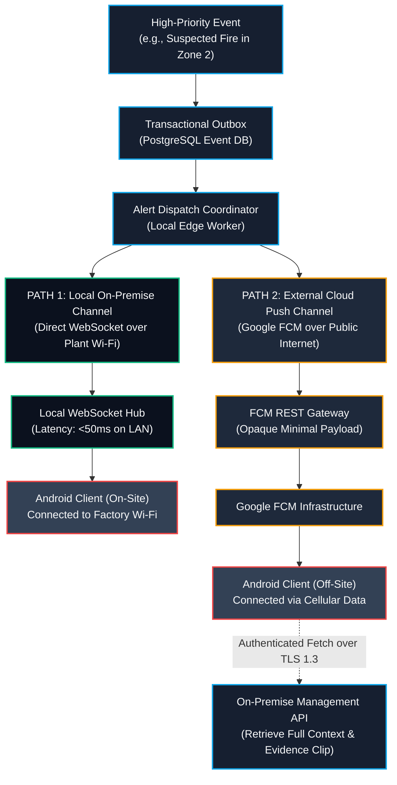

# 30 — Alert Delivery Architecture, FCM Fallback & Degraded Mode Specification

**Document ID:** DISC-30-ALERT-DEGRADED  
**Version:** 1.0.0  
**Date:** 2026-11-11  
**Status:** PROPOSED ARCHITECTURAL SPECIFICATION  
**Classification:** `PROPOSED` (System Design & Reliability Specification)  
**Directive Reference:** Findings P0-07 & P1-10 of CTO Review  

---

## 1. Executive Reliability Reality: The External Push Cloud Dilemma

In strict adherence to Finding P0-07 of the CTO Review:
> **A life-critical fire or industrial safety alert must NEVER rely solely on an external commercial cloud push service (such as Google Firebase Cloud Messaging).**
> FCM requires:
> 1. Outbound internet connectivity from the on-premise factory server.
> 2. Active WAN connectivity between Google datacenters and the cellular provider.
> 3. Active 4G/5G/WiFi data connectivity on the mobile handset.
> 4. Google Play Services running unthrottled by Android OS battery optimization (Doze mode).
> 
> If the factory internet link is cut or mobile signal drops inside a reinforced steel manufacturing building, **external cloud push notifications fail completely**.

This document defines the **Multi-Tiered Hybrid Alert Delivery Model** and the **Degraded Mode Operating Topology** governing BNF and RNF.

---

## 2. Multi-Tiered Hybrid Alert Delivery Architecture



### 2.1 The Two Parallel Delivery Paths

#### Path 1: Local On-Premise Direct WebSocket (Primary for On-Site Personnel)
- **Transport:** Persistent, bidirectional TLS-encrypted WebSocket connection (`wss://gateway.site.local/ws/alerts`) maintained directly between the Android application and the local factory edge server while connected to plant Wi-Fi.
- **Latency:** Sub-100 milliseconds ($< 100\text{ms}$) deterministic local delivery.
- **Internet Dependency:** **Zero.** Operates seamlessly during complete external WAN/ISP outages.
- **Handshake & Heartbeat:** Ping/pong heartbeat every 15 seconds; instant reconnect backoff if Wi-Fi roams.

#### Path 2: External Cloud Push via FCM (Secondary for Off-Site Managers)
- **Transport:** HTTP v1 Google Firebase Cloud Messaging API.
- **Payload Privacy Rule:** **FCM payloads carry ZERO sensitive personal data, zero employee names, and zero camera snapshots.**
  - *Transmitted Payload Schema:*
    ```json
    {
      "message": {
        "token": "<device_fcm_token>",
        "data": {
          "event_id": "8f3b2a1c-99d1-4e88-b712-4412e8b0a112",
          "site": "BNF",
          "severity": "CRITICAL",
          "type": "fire.suspected",
          "ts": "1731360060"
        },
        "android": { "priority": "high" }
      }
    }
    ```
- **Authenticated Retrieval:** Upon receiving the push notification, the Android app wakes up, issues an authenticated request to the on-premise API over TLS 1.3 using the stored JWT, and downloads the full event context, snapshot thumbnail, and live WebRTC stream link.

---

## 3. Delivery Semantics, State Tracking & Audit

The system explicitly distinguishes between a **Dispatch Attempt** and a **Confirmed Delivery**:

```text
+-------------------+---------------------------------------------------------------------------------+
| DELIVERY STATE    | TECHNICAL DEFINITION & AUDIT LOGGING                                            |
+-------------------+---------------------------------------------------------------------------------+
| DISPATCHED        | Alert has been published to local WebSocket and submitted to FCM gateway.       |
| DELIVERED_LAN     | Handset sent application-level ACK over local WebSocket connection.             |
| DELIVERED_PUSH    | Handset woke up via FCM and successfully acknowledged receipt to on-prem API.   |
| VIEWED_BY_USER    | User opened the notification and viewed the incident detail screen.             |
| ACKNOWLEDGED      | User pressed explicit "Triage / Acknowledge" button in incident follow-up.      |
| UNDELIVERED       | ACK not received within 60 seconds; automatic escalation to secondary roster.   |
+-------------------+---------------------------------------------------------------------------------+
```

### Reliability Mechanisms:
1. **At-Least-Once Outbox Delivery:** Notifications are retried using exponential backoff (1s, 2s, 4s, 8s, 16s) until positive delivery ACK is received or retry limit (5 attempts) is exhausted.
2. **Mandatory Client-Side Idempotency:** The Android client maintains an in-memory and local SQLite cache of processed `event_id` keys. Duplicate pushes resulting from network retries are acknowledged and silently deduplicated without triggering repeated ring/vibration alerts.
3. **Emergency Escalation (Safety Failsafe):** If a fire alert remains unacknowledged by on-site safety personnel after **120 seconds**, the system automatically dispatches an escalated notification to the Corporate Security Director and secondary plant managers.

---

## 4. Management Plane Hosting Topology & Degraded Operating Modes

In accordance with Finding P1-10 of the CTO Review:

### 4.1 Deployment Topology (Active-Active Edge Nodes)
To prevent creating a single point of failure:
- **Management API / Context Router Hosting:** Deployed redundantly as a lightweight service running on the **BNF Edge Server (Primary Router)** and mirrored on the **RNF Edge Server (Secondary Standby Router)**, or hosted in an isolated corporate DMZ.
- **DNS / Load Balancing:** Mobile clients resolve `surveillance.company.local` which points to local edge IPs with automatic split-horizon DNS.

### 4.2 Degraded Mode Operating Matrix (WAN Failure Scenarios)

| Failure Scenario | Impact on Local Operations | Impact on Cross-Site Operations | Recovery & Re-Synchronization Behavior |
|---|---|---|---|
| **Scenario 1: Complete Inter-Factory WAN Outage** (Link between BNF and RNF severed) | **ZERO IMPACT.** BNF and RNF continue 100% of camera ingestion, AI inference, local WebSocket alerting, and video recording. | Managers cannot switch between factories. BNF managers see BNF only; RNF managers see RNF only. | When WAN restores, local event buffers re-sync to the central audit archive automatically. |
| **Scenario 2: Total Internet Loss (WAN / ISP Down)** | **ZERO IMPACT.** All on-site camera monitoring, local WebSocket alerts, and NVR playback continue over local LAN. | Remote managers off-site cannot receive FCM pushes or view streams remotely. | FCM queue resumes when ISP link restores; local audit logs record offline duration. |
| **Scenario 3: Single Camera / NVR Hardware Failure** | Affected camera flagged as `OFFLINE`. Other 199 cameras continue processing unaffected. | None. Offline status reflected in health dashboard. | Health watchdog polls RTSP port every 30s; automatically resumes streaming upon camera reboot. |
| **Scenario 4: Edge AI Worker Process Crash** | Systemd watchdog instantly restarts worker process (<5s). Event stream buffered in Valkey. | Temporary 5-second gap in AI observations; zero impact on NVR video recording. | Worker resumes consumption from Valkey Streams checkpoint without losing unprocessed frames. |

---

## 5. Alert & Degraded Mode Specification Sign-Off

- **Status:** PROPOSED RELIABILITY SPECIFICATION.
- **Action Item:** Review with Factory Safety Directors to approve the 120-second emergency escalation threshold.

