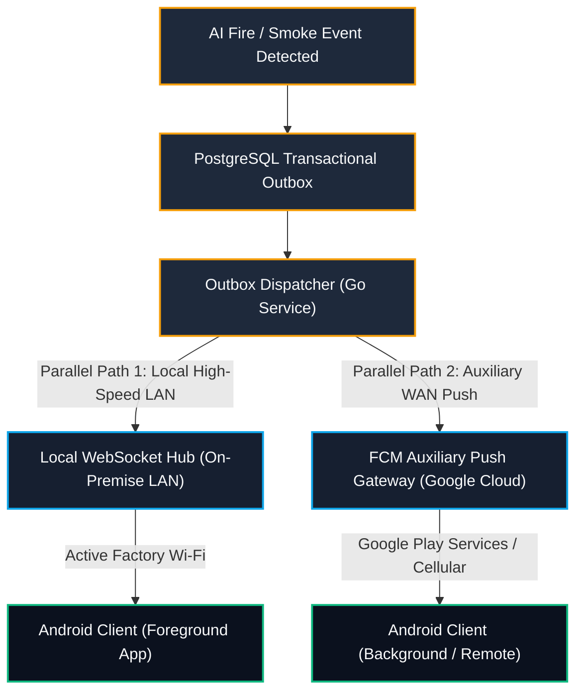

# 39 — Alert Notification Delivery & Fire Alarm Failure Mode Matrix

**Document ID:** DISC-39-ALERT-RELIABILITY  
**Version:** 1.1.0-canonical  
**Date:** 2026-11-11  
**Status:** CANONICAL RELIABILITY SPECIFICATION  
**Classification:** `VERIFIED_OFFICIAL_SOURCE` & `CALCULATED_FROM_EXPLICIT_ASSUMPTIONS`  
**Traceability Reference:** CTO Directive — Phase 0 Final Consistency Gate, Sections 9 & 10  

---

## 1. Executive Summary & Reality Check

Previous discovery drafts proposed that fire alerts would achieve "<800ms end-to-end dispatch" across mobile clients using local WebSockets and Firebase Cloud Messaging (FCM).

**[UNCOMFORTABLE ENGINEERING TRUTH]:** 
1. Neither WebSockets nor FCM can guarantee <800ms handset-level delivery under real-world industrial mobile conditions.
2. A WebSocket connection requires an active, foreground Android application process with an open TCP socket; Android Doze mode and OEM battery management terminate background WebSockets within minutes.
3. FCM is an external Google cloud service dependent on external WAN connectivity, Google infrastructure availability, and carrier network latency. Google does not guarantee deterministic delivery latencies. FCM high-priority messages frequently suffer 2–15 second latencies or throttling under aggressive Android Doze / Standby bucket restrictions.
4. **An optical AI camera notification must NEVER be the primary or sole life-safety fire alarm.** Optical AI is strictly an **auxiliary early-warning tool** that operates alongside independently approved physical industrial fire alarm panels and certified audible evacuation sirens.
5. **No Direct FACP Triggering:** The AI system will **NOT** be connected via hardware relays to trigger physical building Fire Alarm Control Panels (FACP) or evacuation horns.

---

## 2. Latency Decomposition: Server Dispatch vs. Handset Presentation

Latency claims must distinguish between what the server controls and what the handset/network controls:

$$\text{Latency}_{\text{total}} = T_{\text{detect}} + T_{\text{ingest}} + T_{\text{db}} + T_{\text{transport}} + T_{\text{client\_wakeup}} + T_{\text{ui\_render}}$$

```text
+----------------------------+------------------------------------------+-------------------------------------------------------------+
| PIPELINE STAGE             | ESTIMATED DURATION (UNVALIDATED)         | OPERATIONAL REALITY & CONSTRAINTS                           |
+----------------------------+------------------------------------------+-------------------------------------------------------------+
| 1. AI Flame/Smoke Detection| 100 – 250 ms (Historical Estimate)       | Candidate AI runtime (subject to ADR-011 & benchmarking).   |
| 2. Event Normalization     | 10 – 30 ms                               | Payload construction and zone policy lookup.                |
| 3. Database Outbox Commit  | 20 – 50 ms                               | Candidate PostgreSQL outbox table (subject to ADR-011).     |
| 4. Outbox Notify (LISTEN)  | 5 – 15 ms                                | PostgreSQL 16 LISTEN/NOTIFY fire channel (Valkey removed).  |
+----------------------------+------------------------------------------+-------------------------------------------------------------+
| SERVER DISPATCH LATENCY    | 135 – 345 ms (Historical Estimate)       | Candidate engineering target: <500 ms (not an approved SLO).|
+----------------------------+------------------------------------------+-------------------------------------------------------------+
| 5. Transport Latency:      |                                          |                                                             |
|    - Local WebSocket (LAN) | 10 – 80 ms                               | If app is in foreground and on factory Wi-Fi.               |
|    - FCM Remote Push (WAN) | 1,200 – 8,000 ms                         | Traverses external WAN to Google, down to cellular/Wi-Fi.   |
| 6. Handset OS Wakeup:      |                                          |                                                             |
|    - App in Foreground     | 0 ms                                     | Already active.                                             |
|    - App in Background     | 500 – 5,000 ms                           | Android Doze wakeup, WakeLock acquisition, service start.   |
| 7. Audio / Haptic Alerting | 50 – 100 ms                              | Flutter UI thread rings alarm and activates vibration.     |
+----------------------------+------------------------------------------+-------------------------------------------------------------+
| END-TO-END LATENCY (TOTAL) | Foreground: <600 ms (Candidate Target)   | Handset presentation is ONLY sub-second when app is active. |
|                            | Background: 2 – 10 s (Field Estimate)    | Under standard Android background/cellular conditions.      |
+----------------------------+------------------------------------------+-------------------------------------------------------------+
```

> **GOVERNANCE RULE ON PERFORMANCE:** The <500ms server dispatch value is a candidate engineering target only. It is not an approved contractual or production acceptance SLO. It requires explicit owner acceptance and empirical benchmarking under documented load and network conditions. We do **NOT** claim an unconditional end-to-end handset delivery of <800 ms for background mobile devices without empirical field measurement across actual factory handsets in Phase 6/7.

---

## 3. Dual-Channel Notification Architecture



### 3.1 Delivery Mechanisms
1. **Local WebSocket Channel (Primary On-Site Delivery):**
   - Active when Android app is in foreground and connected to factory Wi-Fi.
   - Bypasses public internet entirely; operates during complete WAN outages.
   - Delivers instant audio/visual alarm screen overlay.
2. **Firebase Cloud Messaging (FCM) High-Priority (Auxiliary Remote Delivery):**
   - Utilized for managers and security heads off-site or when app is backgrounded.
   - Formatted strictly for Android HTTP v1 API specifications:
     ```json
     {
       "message": {
         "token": "device_registration_token",
         "android": {
           "priority": "HIGH",
           "notification": {
             "channel_id": "industrial_safety_emergency",
             "priority": "MAX",
             "default_vibrate_timings": true,
             "visibility": "PUBLIC"
           },
           "data": {
             "event_id": "EVT-10492",
             "site_id": "BNF",
             "event_type": "FIRE_SMOKE_ALERT",
             "camera_id": "CAM-BNF-014",
             "timestamp": "2026-11-11T20:15:00Z"
           }
         }
       }
     }
     ```
   - *Note on Configuration:* iOS-specific flags such as `content_available` are omitted. Android utilizes high-priority data payloads paired with custom notification channels.
3. **Strict Exclusion of Direct Fire Alarm Control Panel (FACP) Triggering:**
   - The AI platform is an auxiliary visual surveillance and notification system.
   - **It does NOT connect to or trip building fire alarm panels, evacuation horns, or sprinkler systems.**
   - Triggering physical building evacuation alarms from computer vision without certified life-safety hardware (NFPA 72 / Egyptian Civil Defense approval) presents severe false-alarm evacuation risks, legal liability, and regulatory non-compliance. Any future hardware relay integration remains an optional, separate research proposal requiring formal fire engineering certification.

---

## 4. Comprehensive Delivery Failure Mode Matrix

```text
+------------------------------+---------------------------+---------------------------------+-----------------------------------------------------------+
| FAILURE CONDITION            | WEBSOCKET BEHAVIOR        | FCM REMOTE PUSH BEHAVIOR        | SYSTEM DEGRADED MITIGATION & ESCALATION                   |
+------------------------------+---------------------------+---------------------------------+-----------------------------------------------------------+
| 1. WAN Internet Disconnected | UNAFFECTED                | FAILS COMPLETELY                | Local WebSocket delivers alert immediately to all on-site |
|    (Fiber cut to factory)    | (Runs on local LAN/Wi-Fi) | (Google servers unreachable)    | devices. Outbox retains FCM message for retry post-WAN.   |
+------------------------------+---------------------------+---------------------------------+-----------------------------------------------------------+
| 2. Factory Wi-Fi Offline /   | FAILS                     | UNAFFECTED                      | Devices fall back to cellular data; FCM delivers push     |
|    AP Reboot                 | (Socket disconnects)      | (If cellular data active)       | notification within 2–6 seconds.                          |
+------------------------------+---------------------------+---------------------------------+-----------------------------------------------------------+
| 3. App Terminated / Swiped   | FAILS COMPLETELY          | DELIVERS PUSH NOTIFICATION      | FCM wakes up Android system notification tray; clicking   |
|    by User from Recents      | (Process killed)          | (Handled by OS system service)  | notification launches app directly to Incident Screen.     |
+------------------------------+---------------------------+---------------------------------+-----------------------------------------------------------+
| 4. Android Doze Mode / Deep  | FAILS                     | DELAYED OR THROTTLED            | App requests battery optimization whitelist. Even so,     |
|    Battery Sleep             | (OS suspends socket)      | (OEM battery engine dependent)  | aggressive OEM killers (MIUI/HyperOS, Samsung) may delay. |
+------------------------------+---------------------------+---------------------------------+-----------------------------------------------------------+
| 5. Google Play Services      | UNAFFECTED                | FAILS COMPLETELY                | Detection of missing Play Services triggers fallback to   |
|    Unavailable (Rugged Device| (Uses direct WebSocket)   | (FCM registration impossible)   | persistent foreground Android background worker service.  |
+------------------------------+---------------------------+---------------------------------+-----------------------------------------------------------+
| 6. Handset Powered Off /     | FAILS                     | FAILS                           | Server tracks delivery ACK. Proposed escalation routes     |
|    Zero Battery              |                           | (Enqueued in Google cloud)      | to next available personnel upon unacknowledged timeout.  |
+------------------------------+---------------------------+---------------------------------+-----------------------------------------------------------+
```

---

## 5. Acknowledgments, Retries & Reconciliation

### 5.1 End-to-End Acknowledgment (ACK) Protocol
1. **Server Dispatch:** Outbox worker writes record with status `DISPATCHED` and monotonic sequence number.
2. **Client Receipt ACK:** As soon as handset receives payload via WebSocket or FCM, it transmits `POST /api/v1/alerts/{id}/ack-received`. Status updates to `DELIVERED_TO_HANDSET`.
3. **User Action Triage:** User taps "Acknowledge" on screen. Status updates to `ACKNOWLEDGED_BY_USER` with user ID and Cairo timestamp.
4. **Escalation Policy:** Proposed automated re-routing to secondary safety managers if an alert is unacknowledged remains `PROPOSED` pending Project Owner review of `DEC-05`.

### 5.2 Reconnection Reconciliation
When an Android client reconnects after a network drop or device wake:
1. Client sends `last_received_alert_id` via WebSocket handshake.
2. Server queries PostgreSQL outbox for any events where `id > last_received_alert_id` scoped to the active factory.
3. Server streams all unread alerts immediately; client renders an explicit catch-up banner: *"3 unread alerts received during offline period."*

---

## 6. Fire Safety Governance Statement

> **FORMAL GOVERNANCE POLICY:**
> The Industrial AI Surveillance Platform is an **information and auxiliary surveillance system**. It is NOT certified under NFPA 72 (National Fire Alarm and Signaling Code) or Egyptian Civil Defense fire alarm standards.
> 
> Under no circumstances may site management decommission, silence, or reduce maintenance on the physical fire alarm system or evacuation protocols. In the event of a fire alert on the mobile app, personnel must verify the hazard while conventional emergency protocols remain strictly authoritative.
