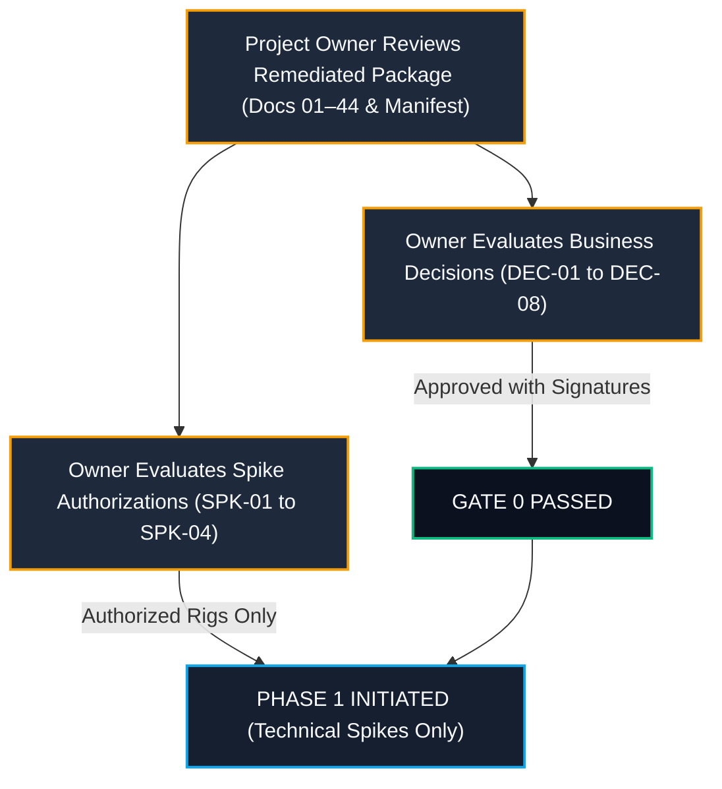

> ⚠️ SUPERSEDED / REFERENCE-ONLY (2026-11-16). Do NOT use as a source of truth. Authoritative: 00_READ_ME_FIRST.md and docs/governance/CTO_AMENDMENTS.md. Known stale content: counts of requirements, banned stack (YOLOv8/TensorRT/DeepStream/MinIO/Valkey/TimescaleDB/React), capacity sizing, "VERIFIED_BY_EXECUTION" labels, Docker Desktop/Go 1.22 LTS claims.

# 41 — Owner Approval Gaps & Governance Boundaries Register

**Document ID:** DISC-41-OWNER-GAPS  
**Version:** 1.1.0-canonical  
**Date:** 2026-11-11  
**Status:** CANONICAL GOVERNANCE AUDIT  
**Classification:** `VERIFIED_OFFICIAL_SOURCE` (CTO Consistency Gate)  
**Traceability Reference:** CTO Directive — Phase 0 Final Consistency Gate, Sections 2 & 13  

---

## 1. Executive Summary & Reality Check

In accordance with CTO Operating Principles:
> **Engineering recommendations must NEVER be presented as owner approvals. A technical proposal remains `PROPOSED` until the Project Owner explicitly reviews, accepts, and signs off on the specific business trade-off in writing.**

This document provides a clean, unambiguous separation between **Owner Decisions (Business, Scope, Policy & Legal)** and **Engineering Spike Authorizations (Temporary Technical Verification Rigs)**. It catalogs every active approval gap that currently blocks transition to implementation.

---

## 2. Segregated Matrix: Owner Decisions vs. Engineering Spike Authorizations

```text
====================================================================================================
                        GROUP A: OWNER BUSINESS & POLICY DECISIONS
====================================================================================================
```

| Canonical ID | Decision Topic | Current Status | Engineering Recommendation | Risk of Starting Without Approval |
|---|---|---|---|---|
| **DEC-01** | Acceptance of Phase 0 Discovery & Remediation Baseline (Package v1.0.3 / Docs 01–44) | `AWAITING SIGN-OFF` | **APPROVE:** Locks requirements baseline (SRS 1.0.0, 96 reqs), evidence classifications, package version 1.0.3, central status register (PROJECT_HANDOFF.md), and cryptographic checksums. | Architectural churn, unaligned expectations, scope creep. |
| **DEC-02** | Web Administration Console Scope Approval | `PROPOSED` | **APPROVE:** Provide lightweight on-premise browser console for zone drawing, camera inventory, and audit logs. | Drawing complex polygon geofences on 6-inch phone screens is an operational failure. |
| **DEC-03** | Biometric Fallback Policy (Photo Upload Portal) | `PROPOSED` | **APPROVE:** Deploy administrative photo upload studio in Web Admin if ZKTeco terminals export templates only. | Project halt if physical terminal firmware prevents photo retrieval. |
| **DEC-04** | Zero-Gate Fire Alert Auxiliary Status Acknowledgment | `AWAITING SIGN-OFF` | **APPROVE:** Acknowledge video fire AI is an auxiliary early-warning tool, not certified NFPA replacement. | Unquantified corporate legal liability in the event of industrial fire. |
| **DEC-05** | Fire Emergency Recipient Roster Submission | `AWAITING SUBMISSION` | **MANDATORY:** Owner must submit exact names, titles, and phone numbers for BNF and RNF. | Inability to configure fire notification routes in Phase 5. |
| **DEC-06** | Legal Counsel Engagement for Law 151/2020 & Decree 816/2025 | `AWAITING SUBMISSION` | **MANDATORY:** Corporate counsel must review Document 34 and initiate PDPC licensing. | Severe criminal and civil penalties under Egyptian data protection law. |
| **DEC-07** | Operational Calendar Cutoff Approval | `PROPOSED` | **APPROVE:** Adopt 23:59:59 `Africa/Cairo` daily reporting boundary with Law 24/2023 DST rules. | Shift reporting misalignment between factory operations and database rollups. |
| **DEC-08** | Cloud Push Notification Service (FCM) Authorization | `PROPOSED` | **APPROVE:** Authorize FCM for auxiliary off-site alert push, acknowledging external network and cloud dependency. | Off-site managers receive zero push notifications when away from factory Wi-Fi. |

> **GOVERNANCE NOTE:** Video viewing permissions are already established as an approved mandatory requirement under **`D-011`** (live and recorded video streaming restricted strictly to Security Managers and Senior Management). This is a confirmed constraint, not an open owner decision.
>
> **LEGAL CLARIFICATION ON FIRE SAFETY (DEC-04):** DEC-04 acknowledges the intended auxiliary status and limitations of AI fire/smoke notifications. It does not waive, transfer, or eliminate any legal responsibility, and it does not establish certification or compliance with a fire-safety standard. Legal review remains independently required.

```text
====================================================================================================
                 GROUP B: ENGINEERING TECHNICAL SPIKE AUTHORIZATIONS (PHASE 1)
====================================================================================================
```

| Canonical ID | Technical Spike Scope | Current Status | Physical Resource Required | Governance & Safety Boundary |
|---|---|---|---|---|
| **SPK-01** | ZKTeco Read-Only Photo Extraction Test | `AWAITING AUTHORIZATION` | 1 isolated test terminal on bench switch. | Read-only API calls; 1 test employee profile; zero write permissions. Resolves `BLK-001`. |
| **SPK-02** | On-Premise GPU Inference Benchmark Rig | `AWAITING AUTHORIZATION` | 1 local GPU workstation (RTX 3090/4000/A4000). | **Zero real factory video on public cloud.** Synthetic test loops. Resolves `BLK-002`. |
| **SPK-03** | NVR RTSP & WebRTC Playback Seek Spike | `AWAITING AUTHORIZATION` | 1 test NVR + 2 test cameras. | Isolated test VLAN; zero traffic on production surveillance network. Resolves `BLK-003`. |
| **SPK-04** | SQL Server Read-Only Schema Discovery | `AWAITING AUTHORIZATION` | Restored staging database backup. | Read-only service account; zero PII data extraction; staging only. Resolves `OQ-005`. |

---

## 3. Explicit Prohibitions Active Until Owner Sign-Off

The following engineering activities remain **STRICTLY BLOCKED AND FORBIDDEN**:

1. **NO Production Server Hardware Purchases:** Sizing models remain calculated estimates until `SPK-02` measures real inference latency on representative factory video loops.
2. **NO Processing of Real Employee Biometric Data:** Zero face embedding extraction on factory workers until legal counsel issues written certification under Egyptian Law 151/2020 and Decree 816/2025 (`BLK-005`).
3. **NO Production Code Scaffolding:** No application backend, mobile app, or database code may be written until Gate 0 is approved.
4. **NO Git / Repository Initialization:** Version control repository creation is held until Phase 2 foundation.
5. **NO Public Cloud Uploads:** No factory CCTV clips, employee photos, or network configurations may be uploaded to external cloud services or public AI endpoints.

### 3.1 Unresolved Requirements Breakdown & Financial Governance Clarification

The 36 requirements currently blocking implementation resolve into 5 explicit categories (detailed in `docs/discovery/43_CURRENT_SRS_96_REQUIREMENT_REAUDIT.md`):

| Classification | Count | Nature of Blocker / Prerequisite |
|---|---:|---|
| **Missing quantitative acceptance criteria** | 14 | Requires representative factory footage, camera angle surveys, network bandwidth probes, or owner-defined tolerance bounds. |
| **Requires owner decision** | 13 | Pending explicit business policy decisions (`DEC-02`, `DEC-03`, `DEC-07`) or architecture selections (`ADR-011`). |
| **Blocked by external hardware/integration dependency** | 5 | Physical equipment access required on test switch (`SPK-01`, `SPK-03`, `SPK-04`). |
| **Requires legal review** | 3 | Egyptian Personal Data Protection Law 151/2020 legal counsel review (`DEC-06`, `DEC-04`). |
| **Incomplete workflow / TBD** | 1 | Incident review and dismissal states undefined (`OQ-021`). |
| **Total Unresolved Requirements** | **36** | **All 36 tracked with explicit resolution dependencies.** |

> **FINANCIAL & PROCUREMENT GOVERNANCE:**
> - Production server hardware purchases remain **STRICTLY PROHIBITED** until empirical GPU benchmarking (`SPK-02`) is authorized and executed.
> - The GPU/edge compute budget question remains open and unresolved under **`OQ-011`**.
> - Financial or CapEx approval has **NOT** been requested, granted, or completed. Any future production server investment requires a distinct, explicit owner authorization.

---

## 4. Owner Decision Workflow


