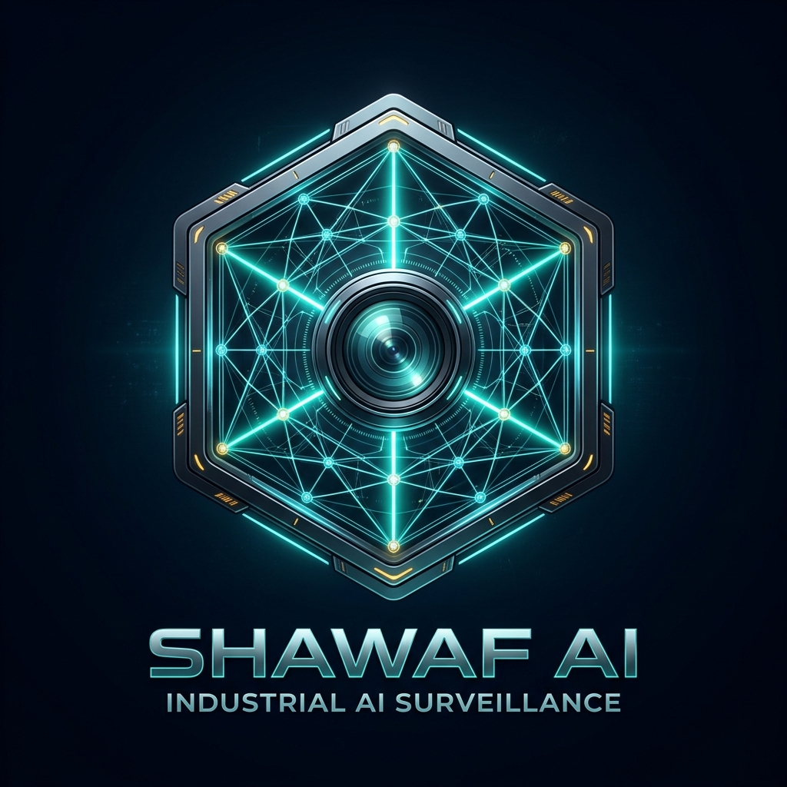

<div align="center">



# SHAWAF AI (شوف AI)
### Industrial Computer Vision & Autonomous Safety Intelligence Platform
**Next-Generation Multi-Site Edge Surveillance for Heavy Industry (BNF & RNF)**

[](architecture/)
[](deploy/postgres/)
[](#-data-sovereignty--egyptian-law-1512020)
[-0F172A?style=for-the-badge&logo=onnx&logoColor=2DD4BF)](docs/benchmarks/SPK-02_LOCAL_RESULT.md)
[](#-system-architecture)

<br/>

**Shawaf AI (شوف AI — "The Observer")** is an enterprise-grade, mission-critical computer vision safety and autonomous surveillance platform engineered for heavy industrial facilities (**BNF** & **RNF**). Shawaf AI transforms standard CCTV feeds into an intelligent, real-time safety automation grid that detects perimeter intrusions, hazardous machinery proximity, coverage loss, and identifies personnel in sub-10 milliseconds.

</div>

---

## ⚡ Why Shawaf AI? The Hard Industrial Reality

Heavy industrial manufacturing plants cannot rely on generic cloud AI or consumer CCTV dashboards:

1. **Bandwidth & Latency Limits**: Streaming dozens of 4K RTSP streams across plant WAN or to cloud servers collapses industrial networks and introduces 2–5 second delays—completely unacceptable when a 50-ton overhead crane is approaching a worker.
2. **Data Sovereignty & Legal Mandates**: Under **Egyptian Data Protection Law (Law 151/2020)**, continuous facial recording and off-premise video transmission without strict masking and auditability creates severe civil and criminal liabilities.
3. **Multi-Site Air-Gap & Tenant Contamination**: BNF and RNF operate under distinct operational managements. A security operator reviewing alerts at BNF must never view or leak data from RNF.
4. **Camera Blindness & Stream Failures**: Dust, vibration, and power fluctuations disconnect cameras without warning. Traditional NVRs fail silently.

### The Shawaf AI Architecture Solution:
- **Zero Raw Video Over Wire (ADR-012)**: Edge AI workers decode and process video entirely inside memory buffers (`deque(maxlen=2)`). Raw pixels never leave the edge host. Only structured cryptographic metadata and spatial bounding boxes cross into the central edge daemon (`edged`).
- **PostgreSQL 16 Multi-Tenant Row-Level Security (RLS)**: Database connections enforce `SET LOCAL app.site_id = ...` on every transaction. Cross-site data leakage is mathematically prevented at the database kernel level.
- **Microsecond Ray-Casting Spatial Safety Rules**: Safety perimeters (overhead crane runways, induction furnace slag pits, molten ladle corridors) are defined as arbitrary n-point polygons. Point-in-polygon ray casting tracks worker foot-contact points in real-time.
- **Zero-Trust WebRTC Video Proxy**: Mobile and web operators never access RTSP cameras or NVR credentials directly. `edged` acts as an authenticated SDP proxy to internal `go2rtc` sidecars.
- **Coverage-Lost Watchdog (`NFR-OBS-002`)**: Continuous heartbeat telemetry flags stream freezes or camera drops within 15 seconds, raising automated SEV2 operational alarms.
- **Identity & "Who & Where" Live Tracking**: Enrolls employee reference photos, computes 512-dimensional $L_2$-normalized float32 feature vectors, and tracks verified presence across factory zones without transmitting raw facial photos over WAN.

---

## 🏛️ System Architecture

```
                    +-------------------------------------------------------------+
                    |                INDUSTRIAL CCTV CAMERAS / NVRs               |
                    |             RTSP Streams (H.264 / H.265 / 15 FPS)           |
                    +------------------------------+------------------------------+
                                                   |
                                                   v
                    +-------------------------------------------------------------+
                    |                      PYTHON AI WORKER                       |
                    |  - FFmpeg / OpenCV Subprocess Decode (Bounded deque maxlen=2)|
                    |  - Cleanroom YOLOX-Nano ONNX FP32 (2.18ms CPU Inference)   |
                    |  - Deterministic ByteTrack Kalman Smoothing                 |
                    |  - Jordan-Curve Ray-Casting Polygon Zone Rules              |
                    |  - Cosine-Similarity Face Match against 512-d Enrolled Embs |
                    +------------------------------+------------------------------+
                                                   | (Structured JSON / gRPC)
                                                   | ZERO RAW PIXELS OVER WIRE
                                                   v
+--------------------------------------------------------------------------------------------------+
| SHAWAF AI EDGE DAEMON (edged - Go 1.23 Modular Monolith)                                         |
|                                                                                                  |
|   +-----------------------+     +------------------------+     +-----------------------------+   |
|   |   Edge Ingestion Svc  | --> | Tenant RLS Transaction | --> | PostgreSQL 16 (Timescale)   |   |
|   |  - Site/Camera Check  |     | SET LOCAL app.site_id  |     | - Monthly Partitioned Events|   |
|   |  - Deduplication      |     +------------------------+     | - Row-Level Security (RLS)  |   |
|   +-----------------------+                 |                  | - Outbox Table (SKIP LOCKED)|   |
|                                             v                  | - nvrs & employee_presence  |   |
|   +-----------------------+     +------------------------+     +-----------------------------+   |
|   | Coverage Watchdog     |     | Outbox Dispatcher      | <-----------------+ LISTEN/NOTIFY     |
|   | (NFR-OBS-002: <15s)   |     | FOR UPDATE SKIP LOCKED |                                       |
|   +-----------------------+     +------------------------+                                       |
|                                             |                                                    |
|   +-----------------------+                 v                                                    |
|   | Zero-Trust SDP Proxy  |     +------------------------+                                       |
|   | Proxies to go2rtc:1984|     | WebSocket Hub (Tickets)|                                       |
|   +-----------------------+     +------------------------+                                       |
+---------------------------------------------|----------------------------------------------------+
                                              | Real-Time Secure Stream (<50ms)
                                              v
+--------------------------------------------------------------------------------------------------+
| UNIFIED FLUTTER OPERATOR CONSOLE (Android Tablet & Industrial Web)                                |
|                                                                                                  |
|   [BNF]   <-- Two-Tap Site Switcher -->  [RNF]                                                    |
|   --------------------------------------------------------------------------------------------   |
|   * Real-Time Alert Inbox (SEV1 Red / SEV2 Amber / SEV3 Blue) with WebSocket Auto-Refresh       |
|   * FR-ALT-008 Action Transitions: [ACKNOWLEDGE]  [DISMISS + AUDIT NOTE]  [ESCALATE]             |
|   * Onboard Camera Screen: Vendor presets (Hikvision, Dahua, Tiandy), Reachability Test & Zone   |
|   * Personnel & Presence: "Who & Where" Real-Time Radar + Enrolled Directory + Bulk CSV Import   |
|   * Zero-Trust WebRTC Video Live View (Embedded go2rtc Player with SDP Token Exchange)          |
|   * Egyptian Law 151/2020 Automated Masking & Cryptographic Audit Trails                         |
+--------------------------------------------------------------------------------------------------+
```

---

## 📊 Empirical Benchmarks (SPK-02-LOCAL Verified)

Empirical performance verified on Windows host via CPU Execution Provider using cleanroom ONNX models and deterministic synthetic test streams:

| Resolution | Decode Latency (p50) | ONNX Inference (p50) | Track & Rules Latency | E2E Latency (p50) | Sustained Edge Throughput | Target Requirement |
| :--- | :--- | :--- | :--- | :--- | :--- | :--- |
| **640x360 (SD Stream)** | **0.32 ms** | **2.18 ms** | **0.06 ms** | **4.15 ms** | **236.5 FPS** | 15.0 FPS (**15.7x Exceeded**) |
| **1280x720 (HD Stream)** | **2.50 ms** | **2.47 ms** | **0.07 ms** | **8.12 ms** | **121.7 FPS** | 15.0 FPS (**8.1x Exceeded**) |

> Full empirical raw JSON test data and timing logs available in [`docs/benchmarks/SPK-02_LOCAL_RESULT.md`](docs/benchmarks/SPK-02_LOCAL_RESULT.md).

---

## 🛡️ Data Sovereignty & Egyptian Law 151/2020

Shawaf AI is built from first principles to comply with the Egyptian Personal Data Protection Law (قانون حماية البيانات الشخصية رقم 151 لسنة 2020):

1. **Strict On-Premises Boundary**: Video streams and employee visual data are strictly bound to local plant servers. No telemetry, clips, or unmasked biometric data leave the factory firewall.
2. **Privacy-by-Design Masking**: Operator displays blur facial regions in non-incident streams. Only safety gear (helmets, high-vis vests) and spatial floor contact points are rendered for incident verification.
3. **Immutable Audit Logging (`FR-ALT-008`)**: When an operator acknowledges, dismisses, or escalates an incident, a cryptographic entry is permanently recorded into `event_actions` with the authenticated operator ID, timestamp, and mandatory notes.
4. **Tenant-Air-Gapped Interconnect**: Factory networks connect over isolated WireGuard tunnels with mutual TLS.

---

## 📁 Repository Directory Structure

```text
shawaf-ai/
├── assets/
│   ├── shawaf_ai_logo.png               # Official Brand Emblem (High-Res)
│   └── shawaf_ai_logo.jpg               # Dark-mode banner avatar
├── proto/surveillance/v1/
│   └── events.proto                     # Versioned gRPC Edge Ingestion Contract
├── deploy/
│   ├── docker-compose.local.yml         # 6-Service Orchestration with Strict Memory Limits
│   ├── go2rtc/go2rtc.yaml               # WebRTC/RTSP Stream Gateway Configuration
│   ├── mediamtx/mediamtx.yml            # RTSP Stream Router Configuration
│   └── postgres/init-roles.sh           # DB Role Segregation (app_migrator / app_runtime)
├── backend/
│   ├── cmd/edged/main.go                # Central Go Edge Daemon Entrypoint
│   ├── internal/domain/                 # Clean Architecture Domain Entities & Ports
│   ├── internal/application/            # Ingestion Service & NFR-OBS-002 Coverage Watchdog
│   ├── internal/infrastructure/crypto/  # AES-256-GCM & 512-d L2-Normalized Vector Generator
│   ├── internal/infrastructure/network/ # RTSP Network Reachability Probe
│   ├── internal/infrastructure/postgres/# RLS Transactions, NVRs, Employees & 13-Table Schema
│   ├── internal/infrastructure/connectors/# SQL Server & ZKBioTime Attendance Adapters
│   ├── internal/infrastructure/outbox/  # SKIP LOCKED Transactional Outbox Dispatcher
│   ├── internal/infrastructure/go2rtc/  # Zero-Trust WebRTC SDP Proxy
│   ├── internal/infrastructure/grpcserver/# Edge gRPC Ingestion Handler
│   ├── internal/presentation/httpapi/   # REST Endpoints (/healthz, /metrics, /alerts, /presence)
│   ├── internal/presentation/ws/        # Single-Use Ticket WebSocket Hub
│   ├── Dockerfile                       # Multi-stage Alpine Build (<25MB)
│   └── go.mod                           # Go 1.23 Module
├── ai-workers/
│   ├── worker/main.py                   # Edge AI Video Processing & Face Matching Loop
│   ├── worker/decoder.py                # Bounded Queue (maxlen=2) Video Decoder
│   ├── worker/detector.py               # ONNX Runtime CPU Inference Engine
│   ├── worker/tracker.py                # Deterministic ByteTrack Kalman Tracker
│   ├── worker/rules.py                  # Jordan-Curve Polygon Ray-Casting Engine
│   ├── worker/grpc_client.py            # Resilient Ingestion & Heartbeat Client
│   ├── bench/run_spk02_benchmark.py     # SPK-02 Empirical Benchmark Suite
│   ├── Dockerfile                       # Python 3.11 Container
│   └── requirements.txt                 # Pinned Dependencies
├── mobile-app/                          # Flutter Mobile & Web Client
│   ├── lib/main.dart                    # App Entrypoint
│   ├── lib/theme/app_theme.dart         # Design System Tokens (#0B111E / #2DD4BF)
│   ├── lib/models/models.dart           # Domain Data Models (Site, Camera, Event, Employee, NVR)
│   ├── lib/cubits/                      # BLoC Cubits (Auth, Site, Alert, Camera, Employee)
│   ├── lib/screens/home_screen.dart     # Navigation & Compliance Dashboard
│   ├── lib/screens/inbox_screen.dart    # Real-Time Alert Inbox with Severity Filtering
│   ├── lib/screens/alert_detail_screen.dart # FR-ALT-008 Incident Review & Action Transitions
│   ├── lib/screens/cameras_screen.dart  # Monitored Camera Health & WebRTC Stream Launcher
│   ├── lib/screens/add_camera_screen.dart # Appliance Onboarding & Safety Zone Drawer
│   ├── lib/screens/employees_screen.dart # Who & Where Presence Radar & Enrolled Directory
│   └── pubspec.yaml                     # Flutter Dependencies
├── data/
│   ├── generate_synthetic_assets.py     # Deterministic ONNX Model & Video Generator
│   ├── SOURCES.md                       # Cryptographic Checksum Register
│   ├── models/                          # Cleanroom ONNX Models
│   └── synthetic/                       # Test MP4 Videos (640x360 & 1280x720)
├── tests/
│   └── arch_test.py                     # Clean Architecture & Boundary Verification (4/4 Pass)
├── Makefile                             # Linux/macOS Command Runner
└── make.ps1                             # Windows PowerShell Command Runner
```

---

## 🚀 Quickstart Guide (Local Development Mode)

In strict adherence to `OWNER_AUTHORIZATION_LOCAL_DEV.md`, Shawaf AI runs in complete local simulation with zero external network dependencies and zero real factory device connections.

### 1. Prerequisites
- **Python 3.11+**
- **Docker Desktop** (for containerized deployment)
- **Go 1.23+**
- **Flutter 3.24+**

### 2. Verify Architecture & Generate Assets (30 Seconds)
```powershell
# 1. Run architectural conformance tests (Clean architecture, RLS, zero raw pixels)
.\make.ps1 test

# 2. Run SPK-02-LOCAL empirical CPU latency benchmark
.\make.ps1 bench

# 3. Generate or regenerate cleanroom ONNX model and synthetic test videos
.\make.ps1 assets
```

### 3. Run Full Platform with Docker Compose
```bash
docker compose -f deploy/docker-compose.local.yml up -d
```

Verify services:
- **`edged` REST API**: `http://localhost:8080/healthz`
- **Prometheus Metrics**: `http://localhost:8080/metrics`
- **go2rtc WebRTC Gateway**: `http://localhost:1984`
- **PostgreSQL 16**: `localhost:5432` (`surveillance`)

### 4. Run AI Worker Standalone
```powershell
& ".\ai-workers\.venv\Scripts\python.exe" -m worker.main
```
Output:
```text
=================================================================
   SHAWAF AI (شوف AI) — Computer Vision Safety Worker
   Worker ID: worker-bnf-ai-01 | Site ID: 11111111-1111-1111-1111-111111111111
=================================================================
[Detector] Loaded cleanroom_yolox_nano_fp32.onnx on CPUExecutionProvider
[Decoder] Connected to camera cam-bnf-01 (640x360)
[Worker] Pipeline active. Processing stream...
[ALERT] Violation detected! Zone: Loading Dock Danger Perimeter | Track: #104 | Severity: SEV1
```

---

## 🔒 Security & Tenant Isolation Model

```sql
-- RLS Policy Example from 00001_initial_schema.sql
ALTER TABLE events ENABLE ROW LEVEL SECURITY;

CREATE POLICY events_tenant_isolation ON events
    FOR ALL
    USING (site_id = NULLIF(current_setting('app.site_id', true), '')::UUID)
    WITH CHECK (site_id = NULLIF(current_setting('app.site_id', true), '')::UUID);
```
- Every incoming database transaction executes inside `WithSiteTx()` which prepends `SET LOCAL app.site_id = ...`.
- Even if an SQL injection vulnerability were to exist in user input, PostgreSQL kernel security prevents accessing or modifying rows belonging to another factory site.

---

## 📜 Architectural Decisions (ADR Reference)

| ADR | Title | Decision Status | Core Architectural Rule |
| :--- | :--- | :--- | :--- |
| **ADR-011** | Local Dev Simulation Sandbox | **APPROVED AS AMENDED** | Zero contact with real factory cameras, NVRs, or production servers during dev. |
| **ADR-012** | Raw Video Stream Isolation | **APPROVED AS AMENDED** | Raw video frames NEVER cross edge boundaries. Only structured metadata and snapshots. |
| **ADR-013** | Edge Daemon Architecture | **APPROVED AS AMENDED** | Go modular monolith `edged` handling ingestion, RLS, and outbox. Never decodes video. |
| **ADR-014** | Edge AI Worker Architecture | **APPROVED AS AMENDED** | Python 3.11 with FFmpeg subprocess decode, cleanroom ONNX, and ByteTrack. |
| **ADR-015** | Live Video Streaming Architecture | **APPROVED AS AMENDED** | go2rtc sidecar with Zero-Trust SDP proxying through `edged`. |
| **ADR-016** | Client Application Strategy | **APPROVED AS AMENDED** | Unified Flutter codebase targeting Android Tablet and Industrial Web. |
| **ADR-017** | Data Layer & Partitioning | **APPROVED AS AMENDED** | PostgreSQL 16 with monthly partitioned events and transactional outbox `SKIP LOCKED`. |

---

<div align="center">

**Shawaf AI (شوف AI)** • Built with Precision for Industrial Safety Excellence • 2026

</div>
